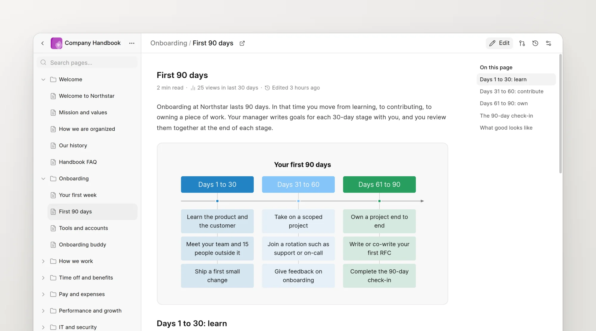
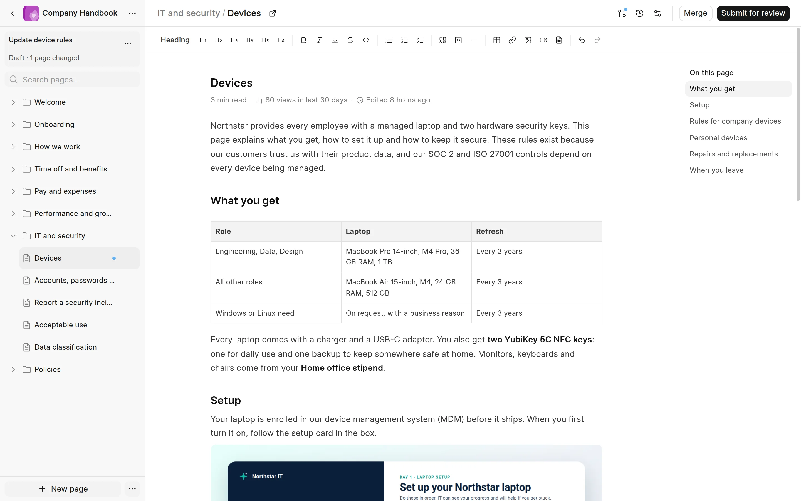
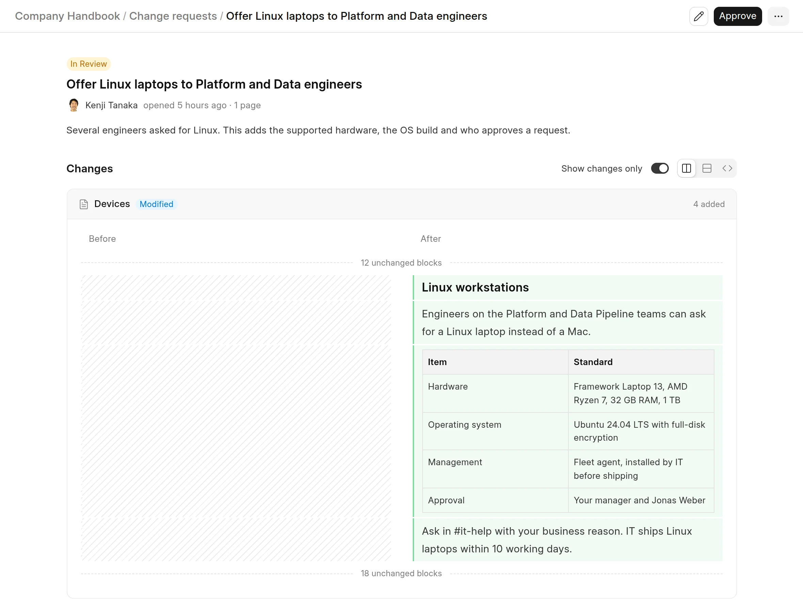
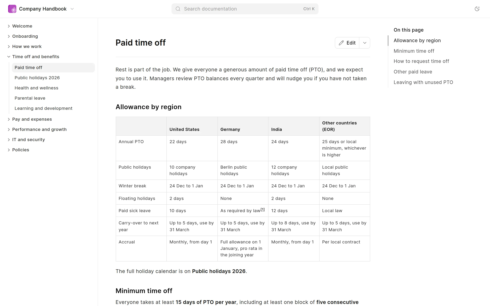
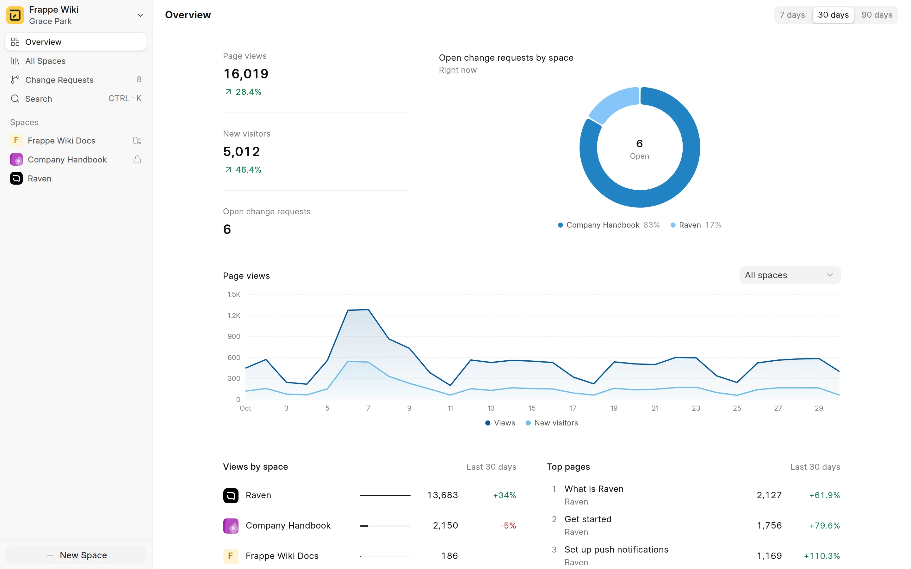
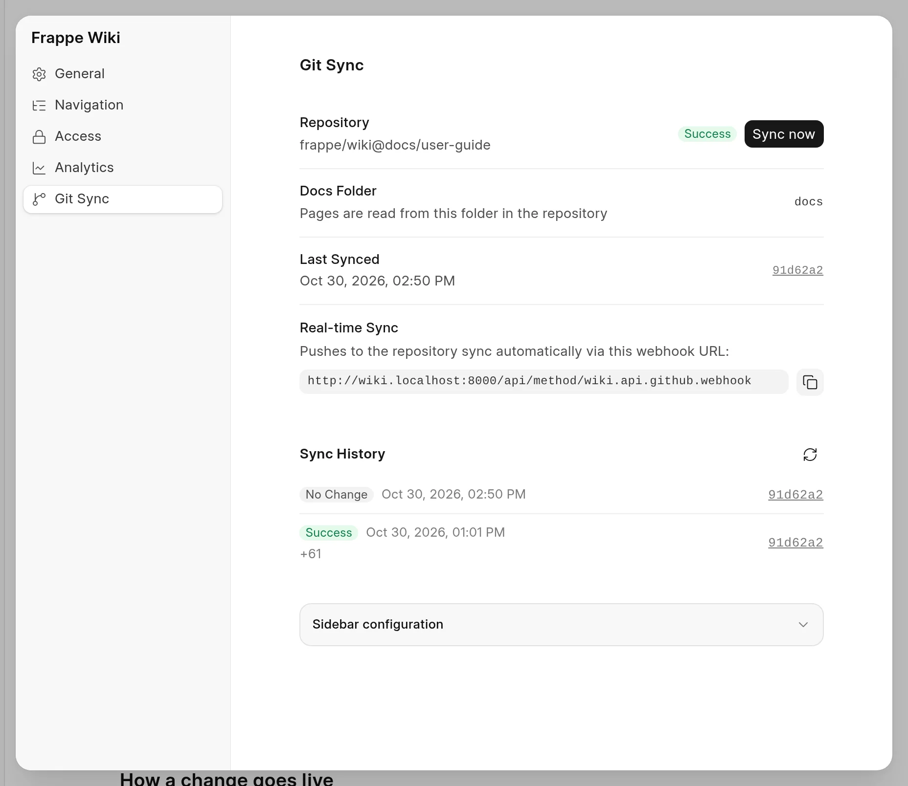
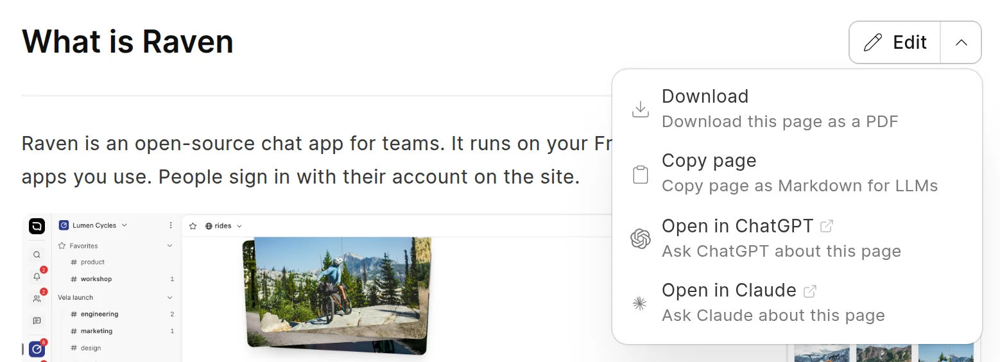

<div align="center">


<h1>Frappe Wiki</h1>

**Open Source Documentation Tool**

[](https://github.com/frappe/wiki/actions/workflows/ci.yml)
[](https://github.com/frappe/wiki/actions/workflows/ui-tests.yml)

<picture>
  <source media="(prefers-color-scheme: dark)" srcset="docs/images/introduction/overview-dark.webp">
  
</picture>

<br />
<br />
<a href="https://frappe.io/wiki">Website</a>
-
<a href="docs/introduction/what-is-frappe-wiki.md">Documentation</a>
</div>

## Frappe Wiki

Frappe Wiki is an open-source wiki app on the Frappe Framework. Use it for product guides, help centers, company handbooks and team notes. Writers work in a rich text editor. Each change goes through review before it goes live, and the wiki keeps the history of every page. Readers get fast, clean pages with search and light and dark mode.

- [Motivation](#motivation)
- [Key features](#key-features)
- [Under the hood](#under-the-hood)
- [Compatibility](#compatibility)
- [Production setup](#production-setup)
- [Development setup](#development-setup)
- [Learn and connect](#learn-and-connect)

### Motivation

Frappe Wiki, like many of our products, started from our own needs. We wanted a simple, clean, open-source wiki for the ERPNext documentation, and we did not find a good one. So we wrote our own.

Our goal was clear: an open-source wiki that writers and readers enjoy. Today we use Frappe Wiki for many things, such as user manuals and company policies. The interface is simple, so anyone on the team can write.

### Key features

- **Spaces.** A space holds the pages of one wiki, such as a product guide or a handbook. Each space has its own URL, logo and access rules. A space can be public, or private to some roles.
- **A rich text editor.** Write with headings, tables, task lists, code blocks, callouts, images, Mermaid diagrams, PDFs and videos. Content is stored as Markdown. An image can have a dark-mode version.
- **Change requests.** Your edits collect in a change request, like a branch. A reviewer reads the diff, then approves, asks for changes or rejects it. When it is merged, the change goes live. Readers can also propose changes.
- **A fast reader.** Published pages have a page tree, a table of contents, search, light and dark mode, and PDF download. Readers can give feedback on each page.
- **Analytics.** See page views, new visitors, top pages and referrers for the whole wiki, a space or one page.
- **GitHub Sync.** Keep a space in step with a folder of Markdown files in a GitHub repository. Preview the folder on your development site before you push.
- **SEO and AI readiness.** Each page has meta tags and a generated social card. The wiki serves a sitemap, a Markdown copy of each page and an `llms.txt` index. A skill lets AI coding agents draft pages through change requests.

<details>
<summary><b>Write</b>: the editor with the page tree, the toolbar and the page</summary>
<br>
<picture>
  <source media="(prefers-color-scheme: dark)" srcset="docs/images/authoring-content/editor-layout-dark.webp">
  
</picture>
</details>

<details>
<summary><b>Review</b>: a change request with the changes side by side</summary>
<br>
<picture>
  <source media="(prefers-color-scheme: dark)" srcset="docs/images/change-requests/review-side-by-side-dark.webp">
  
</picture>
</details>

<details>
<summary><b>Read</b>: a published page with the page tree and the table of contents</summary>
<br>
<picture>
  <source media="(prefers-color-scheme: dark)" srcset="docs/images/introduction/reader-dark.webp">
  
</picture>
</details>

<details>
<summary><b>Measure</b>: page views, top pages and referrers</summary>
<br>
<picture>
  <source media="(prefers-color-scheme: dark)" srcset="docs/images/analytics/overview-dark.webp">
  
</picture>
</details>

<details>
<summary><b>Sync</b>: a space that GitHub Sync keeps up to date</summary>
<br>
<picture>
  <source media="(prefers-color-scheme: dark)" srcset="docs/images/github-sync/git-sync-panel-dark.webp">
  
</picture>
</details>

<details>
<summary><b>Share with AI</b>: copy a page as Markdown, or open it in ChatGPT or Claude</summary>
<br>
<picture>
  <source media="(prefers-color-scheme: dark)" srcset="docs/images/introduction/reader-ai-menu-dark.webp">
  
</picture>
</details>

### Under the hood

- [**Frappe Framework**](https://github.com/frappe/frappe): a full-stack web application framework. It gives the wiki its users, roles, database and API.
- [**Frappe UI**](https://github.com/frappe/frappe-ui): a Vue component library. The wiki app at `/wiki-app` uses it.
- [**Tiptap**](https://github.com/ueberdosis/tiptap): the editor framework. Pages are stored as Markdown.
- [**SQLite**](https://www.sqlite.org/fts5.html): full-text search for the pages.
- [**DuckDB**](https://github.com/duckdb/duckdb): fast counts for the page view analytics.

### Compatibility

This app is compatible with the following versions of Frappe:

| Wiki branch       | Stability | Frappe branch |
| :---------------- | :-------- | :------------ |
| master - v2.x     | stable    | v15.x         |
| version-3 - v3.x  | stable    | v15.x & v16.x |
| develop - nightly | unstable  | develop       |

On Frappe develop, Wiki also runs on SQLite (`bench new-site --db-type sqlite`). Frappe still marks SQLite support as experimental.

## Production setup

### Managed hosting

You can try [Frappe Cloud](https://frappecloud.com), a simple, user-friendly and sophisticated [open-source](https://github.com/frappe/press) platform to host Frappe applications with peace of mind.

It does the installation, setup, upgrades, monitoring, maintenance and support of your Frappe deployments. It is a full developer platform that lets you manage many Frappe deployments.

<div>
    <a href="https://frappecloud.com/marketplace/apps/wiki" target="_blank">
        <picture>
            <source media="(prefers-color-scheme: dark)" srcset="https://frappe.io/files/try-on-fc-white.png">
            
        </picture>
    </a>
</div>

### Self-hosting

Use [Frappe Pilot](https://github.com/frappe/pilot#readme) to host Frappe Wiki on your own server. Pilot installs and manages benches and sites, and sets up production for you.

1. Install Pilot and create a bench. Follow the steps in the [Pilot README](https://github.com/frappe/pilot#readme).
2. Get the app, create a site and install the app on it:

```sh
pilot -b <bench> get-app https://github.com/frappe/wiki --branch version-3
pilot -b <bench> new-site <site>
pilot -b <bench> install-app <site> wiki
```

Then open `/wiki-app` on your site. For more, see [Install Frappe Wiki](docs/introduction/install-frappe-wiki.md).

## Development setup

### Local

1. Set up a bench with [Frappe Pilot](https://github.com/frappe/pilot#readme), or with the [bench CLI](https://frappeframework.com/docs/user/en/installation), and start it:

```sh
bench start
```

2. In another terminal, in the `frappe-bench` folder, get the app and install it on your site:

```sh
bench get-app https://github.com/frappe/wiki
bench --site <site> install-app wiki
```

<details>
<summary><b>Work on the documentation</b></summary>
<br>

The user guide is in [`docs/`](docs/introduction/what-is-frappe-wiki.md). GitHub Sync publishes it, and [`docs/.wiki.yml`](docs/.wiki.yml) sets the order of the sidebar. To see your changes as you write, preview the folder on a development site. The command syncs again when you save a file, and open pages reload:

```sh
bench --site <site> wiki preview-docs apps/wiki/docs --route docs-preview --watch
```

The screenshots are in `docs/images/`, in a light and a dark version. [`scripts/docs-screenshots/`](scripts/docs-screenshots/README.md) takes them again from a site with demo data.

</details>

<details>
<summary><b>Run the tests</b></summary>
<br>

```sh
# Python tests
bench --site <site> run-tests --app wiki

# Browser tests, against a running site
yarn test:e2e
```

</details>

## Learn and connect

- [Telegram Public Group](https://t.me/frappewiki)
- [Discuss Forum](https://discuss.frappe.io/c/wiki/72)
- [Documentation](docs/introduction/what-is-frappe-wiki.md)
- [YouTube](https://www.youtube.com/@frappetech)

<br>
<br>
<div align="center" style="padding-top: 0.75rem;">
    <a href="https://frappe.io" target="_blank">
        <picture>
            <source media="(prefers-color-scheme: dark)" srcset="https://frappe.io/files/Frappe-white.png">
            
        </picture>
    </a>
</div>
