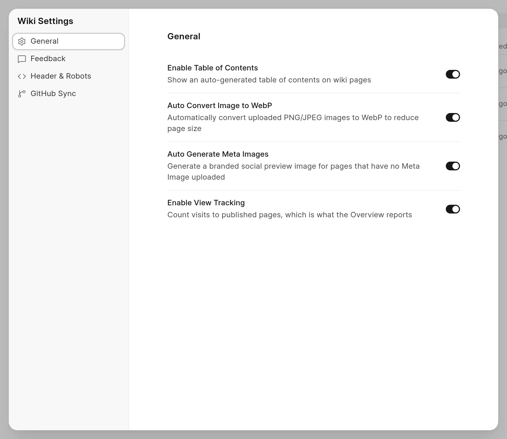
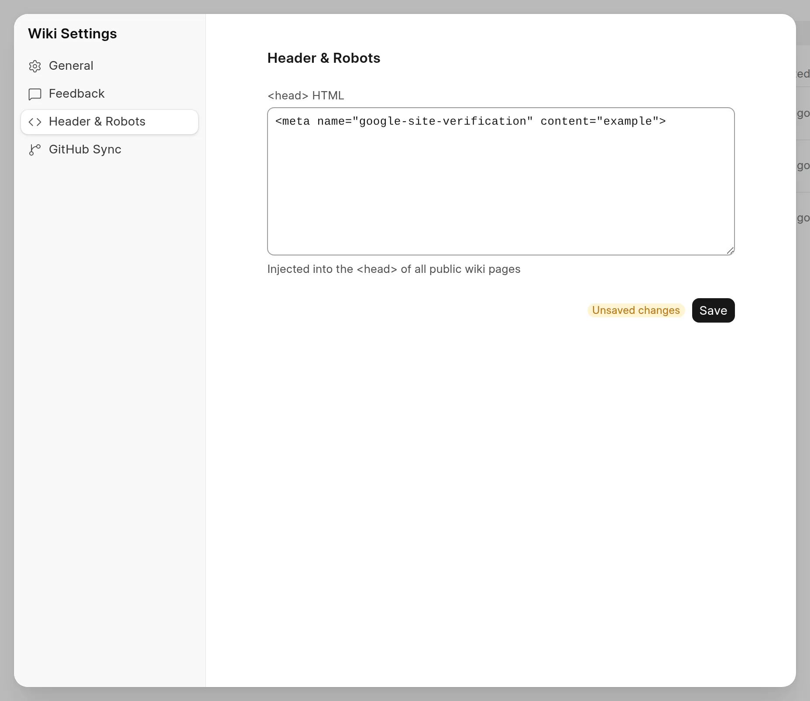

Wiki settings apply to the whole site and to every space on it. Only a Wiki Manager or a System Manager can change them.

## Open the settings

1. In the sidebar, click **Frappe Wiki** at the top.
2. Click **Settings**.

You can also press `Ctrl+K` (`Cmd+K` on a Mac), type `settings` and pick **Settings**.

The **Wiki Settings** dialog has four tabs: **General**, **Feedback**, **Header & Robots** and **GitHub Sync**. A switch saves its change when you click it. You do not need a save button.

<picture>
  <source srcset="../images/administration/wiki-settings-general-dark.webp" media="(prefers-color-scheme: dark)">
  
</picture>

## General

| Setting | What it does | Default |
| :--- | :--- | :--- |
| **Enable Table of Contents** | Shows a table of contents, made from the headings, on published pages. | On |
| **Auto Convert Image to WebP** | Converts PNG and JPEG images to WebP when you upload them in the editor. WebP files are smaller, so pages load faster. Images that GitHub Sync imports are converted too. | On |
| **Auto Generate Meta Images** | Makes a social preview image for each page that has no meta image of its own. See [Social cards](../seo-and-aeo/social-cards.md). | On |
| **Enable View Tracking** | Counts visits to published pages. The **Overview** page shows these counts. See [View tracking](../analytics/view-tracking.md). | Off |

**Auto Generate Meta Images** shows only when the server can make the images. If the server has no image renderer, the setting is not in the list.

Images that you uploaded before you turned on WebP conversion stay as they are.

## Feedback

| Setting | What it does |
| :--- | :--- |
| **Enable Feedback** | Shows the **Feedback Submission Limit** setting. |
| **Feedback Submission Limit** | The number of feedback entries that one IP address can send in one hour. The default is `3`. If you set `0`, the limit is `20`. |

:::note
The feedback widget on a page shows only when the space has **Collect Feedback** on. You set it in the space settings, on the **Access** tab. See [Reader feedback](../analytics/reader-feedback.md).
:::

## Header & Robots

**<head> HTML** is HTML that the wiki adds to the `<head>` of every public wiki page. Use it for an analytics script, a site verification tag or extra `<meta>` tags.

1. Type or paste the HTML.
2. Click **Save**.

The **Unsaved changes** badge shows until you save.

<picture>
  <source srcset="../images/administration/wiki-settings-header-dark.webp" media="(prefers-color-scheme: dark)">
  
</picture>

:::caution
The wiki does not check this HTML. A broken tag or script can break every public page. Add only code that you trust.
:::

To keep one page out of search engines, use the page settings instead. See [Hide a page from search engines](../seo-and-aeo/hide-from-search-engines.md).

## GitHub Sync

This tab holds the GitHub App that GitHub Sync uses. See [Connect a repository](../github-sync/connect-a-repository.md).
