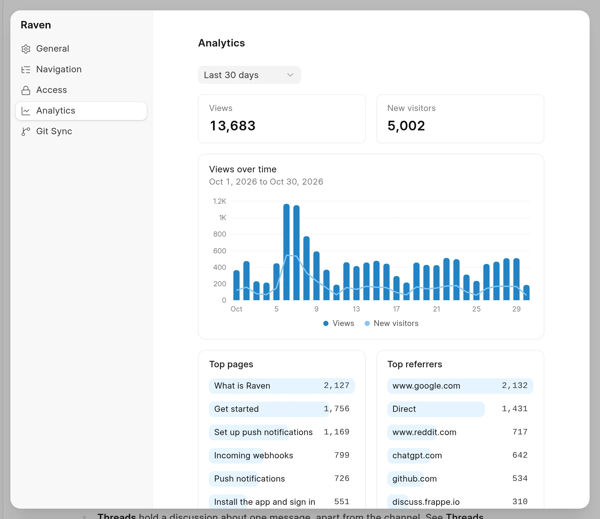

The wiki counts visits to the published pages in the reader. You see the numbers for the whole wiki, for one space and for one page.

The wiki counts views only when view tracking is on. See [Turn view tracking on or off](view-tracking.md).

## The Overview page

Wiki Managers and System Managers see **Overview** at the top of the app sidebar, at `/wiki-app/overview`. Other users go to **All Spaces** instead.

<picture>
  <source srcset="../images/analytics/overview-dark.webp" media="(prefers-color-scheme: dark)">
  
</picture>

Pick **7 days**, **30 days** or **90 days** at the top right. The page shows:

| Part | What it shows |
| :--- | :--- |
| **Page views** | All views of pages in all spaces. |
| **New visitors** | Visitors whose first view falls in the range. |
| **Open change requests** | Change requests that are **In Review**, **Changes Requested** or **Approved** now. Drafts are not counted. |
| **Open change requests by space** | The same change requests, per space. This does not change with the range. |
| **Page views** chart | Views and new visitors per day. Pick a space in the list above the chart, or **All spaces**. |
| **Views by space** | The 5 spaces with the most views. Click a space to open it. |
| **Top pages** | The 5 pages with the most views. Click a page to open it. |
| **Top referrers** | The 5 sites that sent the most views. |

The numbers have a percentage next to them. It compares the range with the range of the same length just before it. If there were no views before, no percentage shows.

## Analytics for one space

You must have write access to the space.

1. Open the space, click **...** next to its name, and click **Space settings**.
2. Click **Analytics**.

<picture>
  <source srcset="../images/analytics/space-analytics-dark.webp" media="(prefers-color-scheme: dark)">
  
</picture>

- Pick a range: **Last 7 days** to **Last 12 months**, or **Custom range**.
- For more than 90 days, each bar is one week. For more than 180 days, each bar is one month. Click a bar to see its days.
- Click a page in **Top pages** to see the numbers for that page only. Click the page name button at the top to go back to the whole space.

A space at a nested route, such as `docs/v2`, counts its own pages. The space at `docs` does not count them.

## Analytics for one page

In the app, the line under the page title shows the views of the last 30 days, for example **120 views in last 30 days**. Click it to open the analytics of that page. The line does not show when the page has no views.

## What the terms mean

- **View**: one time that a reader opened a page.
- **New visitor**: a visitor that the wiki has not seen before. The wiki identifies a visitor by a fingerprint of the browser and device. The same person in another browser counts as another visitor.
- **Referrer**: the site of the link that a reader clicked to come to the page, for example `www.google.com`. Links from one wiki page to another are not referrers. **Direct** means that there was no referrer, for example when a reader typed the URL.

## When the numbers update

A background job copies new views into the analytics store every 10 minutes. A view can take up to 10 minutes to show.
