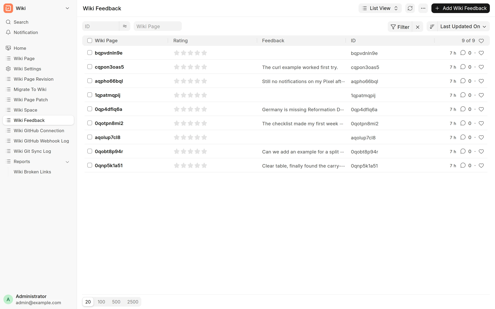
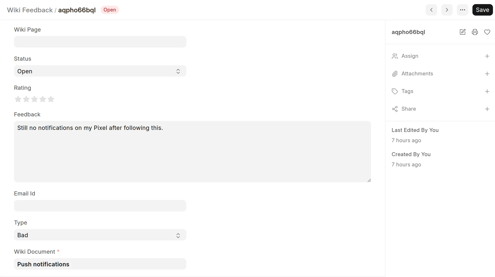

Readers rate pages with **Was this helpful?** at the bottom of each page. The wiki keeps each rating as a **Wiki Feedback** record. You see the records in Desk, the Frappe admin UI at `/app`.

See [Give feedback](../reading/give-feedback.md) for what readers do.

## See the feedback

1. Go to `/app/wiki-feedback` on your site. You can also open the **Wiki** workspace in Desk and click **Wiki Feedback**.
2. Click a record to see all its fields.

<picture>
  <source srcset="../images/analytics/feedback-list-dark.webp" media="(prefers-color-scheme: dark)">
  
</picture>

Use the list filters to find feedback for one page or with one rating. For example, filter **Type** by `Bad` to find pages that need work.

:::note
System Managers and users with the **Wiki Approver** role can read feedback. The **Wiki Manager** role alone cannot.
:::

## What a record contains

| Field | Content |
| :--- | :--- |
| **Wiki Document** | The page that the reader rated. |
| **Type** | The rating: `Good`, `Ok` or `Bad`. |
| **Feedback** | The comment of the reader, if there is one. |
| **Status** | `Open` for new records. Set it to `Closed` when you have acted on the feedback. |
| **Email Id** | Empty for feedback from the reader page. |

The record also shows who sent it and when. Feedback from a visitor who is not logged in shows **Guest** as the sender.

The **Wiki Page** and **Rating** fields belong to Wiki version 2. They are empty for feedback on version 3 pages.

<picture>
  <source srcset="../images/analytics/feedback-record-dark.webp" media="(prefers-color-scheme: dark)">
  
</picture>

The app does not show feedback. To turn the widget on or off for a space, see [Give feedback](../reading/give-feedback.md).
