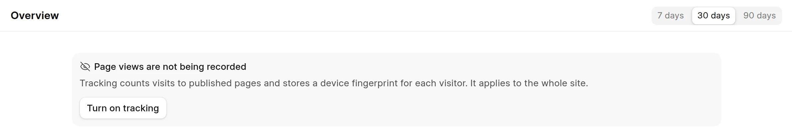

View tracking records each visit to a page in the reader. The [page view analytics](page-views.md) use these records. Only Wiki Managers and System Managers can change the setting.

## Turn tracking on or off

1. In the app, click **Frappe Wiki** at the top of the sidebar and click **Settings**.
2. In **General**, turn **Enable View Tracking** on or off.

<picture>
  <source srcset="../images/analytics/view-tracking-toggle-dark.webp" media="(prefers-color-scheme: dark)">
  
</picture>

When tracking is off, the analytics pages show **Page views are not being recorded**. A Wiki Manager can click **Turn on tracking** in that message.

<picture>
  <source srcset="../images/analytics/tracking-off-notice-dark.webp" media="(prefers-color-scheme: dark)">
  
</picture>

:::caution
This switch is the **Enable View Tracking** setting in Frappe **Website Settings**. It applies to the whole site, also to website pages from other Frappe apps.
:::

When you turn tracking off, the wiki keeps the views it already recorded. The analytics show them, but no new views are added.

## What the wiki stores

For each view, the wiki adds a **Web Page View** record with:

- The path of the page, for example `raven/introduction/what-is-raven`.
- The referrer: the URL of the previous page, without its query string.
- A visitor ID: a fingerprint of the browser and device, made in the browser.
- The user agent of the browser and the time zone.
- The `utm_source`, `utm_medium`, `utm_campaign` and `utm_content` values of the URL, if it has them.

The wiki does not record a view when the browser sends a Do Not Track signal.

Only pages in the reader are counted. Pages that you open in the app are not counted.
