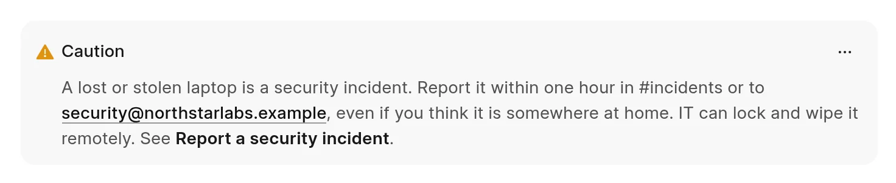

A callout is a box that makes a note, a tip or a warning stand out from the text around it. Each callout has a type, an icon and a title.

<picture>
  <source srcset="../images/authoring-content/callout-dark.webp" media="(prefers-color-scheme: dark)">
  
</picture>

## Add a callout

1. On an empty line, type `/`.
2. Click **Note**, **Tip**, **Warning** or **Danger** in the **Callouts** group. Type `/call` to show only the callouts.
3. Type the text of the callout.
4. Press `Ctrl` + `Enter` (`Cmd` + `Enter` on a Mac) to leave the callout and continue below it.

The body of a callout can hold the same content as the page: formatted text, links, lists, headings, images and code blocks. A callout cannot hold another callout.

## Callout types

| Type | Default title | Use it for |
| :--- | :--- | :--- |
| `note` | Note | Extra information |
| `tip` | Tip | A useful hint or a shorter way |
| `caution` | Caution | Something that can go wrong |
| `danger` | Danger | Something that can cause damage or data loss |
| `warning` | Caution | The same as `caution` |

The **Warning** item in the command menu adds a `caution` callout. The editor saves a `warning` callout as `caution`.

## Change the title or type

- **Title.** Click the title in the callout header and type. Press `Enter` to move to the body. If you clear the title, the default title of the type comes back.
- **Type.** Hold the pointer on the callout and click **...** at the right of the header. Click **Note**, **Tip**, **Caution** or **Danger**. If you did not change the title, it changes to the default title of the new type.
- **Remove.** Click **...**, then **Remove**.

## Markdown form

In Markdown, a callout is a block of lines:

1. The first line is `:::` and the type, for example `:::caution`. To set a custom title, put it in square brackets after the type, for example `:::tip[Keyboard shortcut]`.
2. The body follows on the next lines. It can use any Markdown.
3. The last line holds only `:::`.

Without a title in brackets, the callout shows the default title of its type. When you keep the default title, the editor saves the callout without brackets.

You can paste a callout in this form into the editor as plain text, or use it in files that [sync from GitHub](../github-sync/folder-structure.md).
