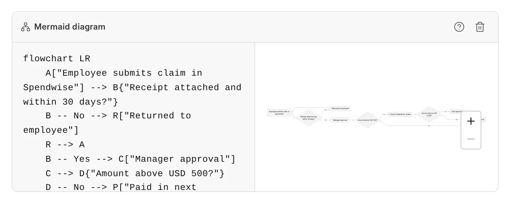
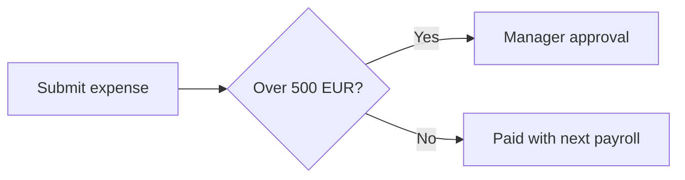
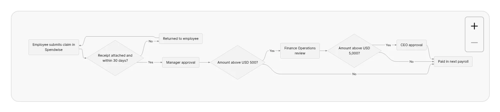

You can draw diagrams in a page with Mermaid syntax. You write the diagram as text, and the wiki draws it. Diagrams follow the light or dark theme of the wiki.

## Add a diagram

1. On an empty line, type `/diagram` or `/mermaid`.
2. Press `Enter`. A **Mermaid diagram** block opens with a small starter flowchart.
3. Replace the starter text with your diagram in the code pane on the left.

The preview on the right updates as you type. If the text has an error, the preview keeps the last drawing that worked, dims it, and shows the error below it.

<picture>
  <source srcset="../images/authoring-content/diagram-block-dark.webp" media="(prefers-color-scheme: dark)">
  
</picture>

The block header has two buttons: **Learn about Mermaid** opens the Mermaid project, and **Remove diagram** deletes the block.

## Markdown form

A diagram is a code block with the language `mermaid`:

````markdown

````

When you paste this Markdown as plain text, or when a file [syncs from GitHub](../github-sync/folder-structure.md), the wiki shows it as a diagram block.

## Diagram types

The wiki draws diagrams with Pele, a renderer for Mermaid syntax. The first word of the diagram sets its type. These types draw:

| First word | Diagram |
| :--- | :--- |
| `flowchart` or `graph` | Flowchart |
| `sequenceDiagram` | Sequence diagram |
| `classDiagram` | Class diagram |
| `stateDiagram` | State diagram |
| `erDiagram` | Entity relationship diagram |
| `gantt` | Gantt chart |
| `pie` | Pie chart |
| `journey` | User journey |
| `gitGraph` | Git graph |
| `mindmap` | Mind map |
| `timeline` | Timeline |
| `quadrantChart` | Quadrant chart |
| `xychart` | XY chart |
| `sankey` | Sankey diagram |
| `block` | Block diagram |
| `packet` | Packet diagram |
| `kanban` | Kanban board |
| `architecture` | Architecture diagram |
| `requirementDiagram` | Requirement diagram |
| `C4Context` | C4 diagram |
| `treemap` | Treemap |

Diagrams cannot contain links or images. The wiki removes them for security.

## On the published page

Readers see only the drawing, centered on the page. A wide diagram shrinks to fit the page width, and zoom controls show on it.

<picture>
  <source srcset="../images/authoring-content/diagram-published-dark.webp" media="(prefers-color-scheme: dark)">
  
</picture>
