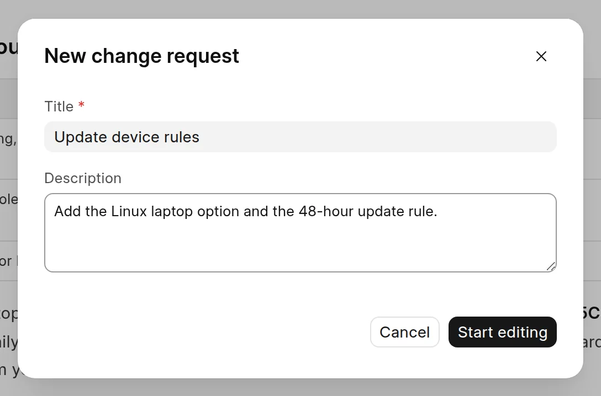

You edit pages in the wiki app at `/wiki-app`. Every edit goes into a change request, and readers see nothing until a reviewer merges it. See [What is a change request](../change-requests/what-is-a-change-request.md).

## Open the editor

1. Open the space and click the page in the sidebar.
2. Click **Edit** at the top right of the page.
3. If you have no open draft in this space, the **New change request** dialog opens. Enter a **Title**, and a **Description** if you like.
4. Click **Start editing**.

<picture>
  <source srcset="../images/authoring-content/new-change-request-dark.webp" media="(prefers-color-scheme: dark)">
  
</picture>

The editor opens with the cursor at the end of the page.

You get no dialog in these cases:

- You already have a change request in **Draft** or **Changes Requested** state in the space. The space opens in edit mode, and your edits go into that change request.
- The space has no pages yet. The wiki starts a change request called "Add initial content" for you.

## Edit from the published page

On a published page, click **Edit** at the top of the page. The page opens in the wiki app at `/wiki-app/spaces/<space>/page/<page>?edit=1`, and the steps above continue from step 3.

The **Edit** button shows when the space accepts contributions, or when you can write to the space. If you are not logged in, you log in first. In a space that syncs from GitHub, **Edit** opens the file on GitHub instead. See [Edit on GitHub](../github-sync/edit-on-github.md).

## The editor layout

<picture>
  <source srcset="../images/authoring-content/editor-layout-dark.webp" media="(prefers-color-scheme: dark)">
  
</picture>

- **Sidebar.** A card at the top shows the change request title and status. Click the title to change the title or description. The **...** menu has **View changes** and **Discard Changes**. The page tree is below the card.
- **Page header.** Breadcrumbs, the open change requests on this page, **Version history**, **Page settings** and **Submit for review**.
- **Toolbar.** Formatting and insert buttons. See [Format text](format-text.md).
- **Title.** Click the title and type. Press `Enter` or click away to save it.
- **Content.** Type `/` for the command menu.
- **Outline.** When the page has headings, an outline of them shows to the right of the content, or above it in a narrow window. It hides while a side panel is open.

## How edits save

You do not need to save. The editor saves the page to your change request 2 seconds after you stop typing, and at least every 10 seconds while you type. Press `Ctrl` + `S` (`Cmd` + `S` on a Mac) to save all your open edits at once.

An amber dot next to the title means the page has changes that are not saved yet. The sidebar card also shows the state: **Unsaved changes**, **Saving…**, **Sync failed** or **Changed elsewhere**. When a save fails or the draft changed in another tab, click **Reload latest** to get the saved version from the server.

Your browser keeps a copy of edits that are not saved yet. If you reload the page, they come back.

## Keyboard shortcuts

| Shortcut | Action |
| :--- | :--- |
| `Ctrl` + `S` | Save all edits now |
| `Ctrl` + `Z` / `Ctrl` + `Shift` + `Z` | Undo / redo |
| `Ctrl` + `K` | Add or edit a link |
| `/` | Open the command menu |
| `[[` | Link to another page |
| `:` | Insert an emoji |

On a Mac, use `Cmd` instead of `Ctrl`. For formatting shortcuts, see [Format text](format-text.md).

:::note
The editor has no Markdown source view. To add Markdown, paste it as plain text. The editor converts it to formatted content.
:::

## When you are done

Click **Submit for review** to send the change request to a reviewer. See [Submit for review](../change-requests/submit-for-review.md).
