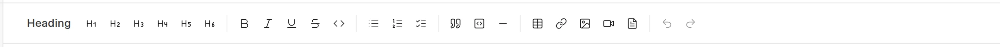
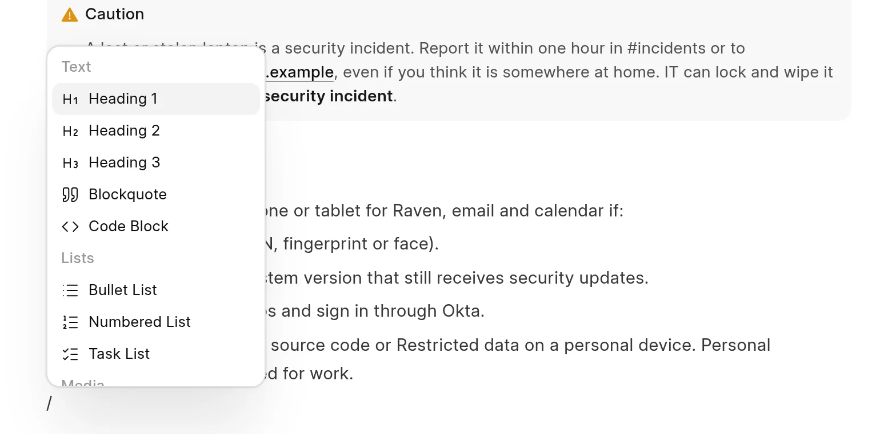

You can format text from the toolbar, from the command menu, or with Markdown shortcuts as you type. The wiki stores the page as Markdown.

## The toolbar

The toolbar is at the top of the editor. Hold the pointer on a button to see its name.

<picture>
  <source srcset="../images/authoring-content/toolbar-dark.webp" media="(prefers-color-scheme: dark)">
  
</picture>

- **Heading** opens a menu with **Heading 1** to **Heading 6**.
- **Bold**, **Italic**, **Underline**, **Strike** and **Code** format the selected text.
- **Bullet List**, **Ordered List** and **Task List** start a list.
- **Blockquote**, **Code Block** and **Horizontal Rule** add a block.
- **Table**, **Link**, **Insert Image**, **Insert Video** and **Insert PDF** add content.
- **Undo** and **Redo**.

When you select text, a small menu also shows above it. It has the text formats, **Link**, **Heading 1** to **Heading 3**, the two lists, **Blockquote** and **Code Block**. This menu does not show on a phone.

## The command menu

Type `/` to open the command menu. Type more letters to filter it, then press `Enter` or click an item.

<picture>
  <source srcset="../images/authoring-content/slash-menu-dark.webp" media="(prefers-color-scheme: dark)">
  
</picture>

| Group | Items |
| :--- | :--- |
| Text | Heading 1, Heading 2, Heading 3, Blockquote, Code Block |
| Lists | Bullet List, Numbered List, Task List |
| Media | Image, Video, PDF |
| Insert | Table, Embed, Diagram, Link to Page, Horizontal Rule |
| Callouts | Note, Tip, Warning, Danger |

## Markdown shortcuts

| Type this | To get |
| :--- | :--- |
| `#` to `######` and a space | Heading 1 to Heading 6 |
| `**text**` | **Bold** |
| `*text*` or `_text_` | *Italic* |
| `~~text~~` | Strikethrough |
| `` `text` `` | Inline code |
| `-`, `*` or `+` and a space | Bullet list |
| `1.` and a space | Numbered list |
| `[ ]` and a space | Task list |
| `>` and a space | Quote |
| ```` ``` ```` and a space | Code block |
| `---` | Horizontal rule |

## Keyboard shortcuts

| Shortcut | Action |
| :--- | :--- |
| `Ctrl` + `B` / `I` / `U` | Bold / italic / underline |
| `Ctrl` + `Shift` + `S` | Strikethrough |
| `Ctrl` + `E` | Inline code |
| `Ctrl` + `Alt` + `1` to `6` | Heading 1 to Heading 6 |
| `Ctrl` + `Shift` + `7` / `8` / `9` | Numbered list / bullet list / task list |
| `Ctrl` + `Shift` + `B` | Quote |

On a Mac, use `Cmd` instead of `Ctrl`, and `Option` instead of `Alt`.

## Code blocks

A code block shows line numbers. Hold the pointer on the block to see the language menu and **Copy code**. The language is **auto** until you pick one. To set it as you type, put the language after the backticks, then a space, for example ```` ```python ````. Press `Tab` and `Shift` + `Tab` to indent lines in the block.

## Tables

Click **Table** in the toolbar and pick a size, or type `/table` for a 3 by 3 table with a header row. When the cursor is in a table, a menu shows controls for rows, columns and cells.

## Spacing

Press `Enter` for a new paragraph. Empty paragraphs stay on the published page as blank space. Press `Shift` + `Enter` for a line break in the same paragraph.

## Other content

- [Callouts](callouts.md)
- [Images](images.md)
- [Diagrams](diagrams.md)
- [PDFs and videos](pdfs-and-videos.md)
- [Link to other pages](link-to-other-pages.md)
