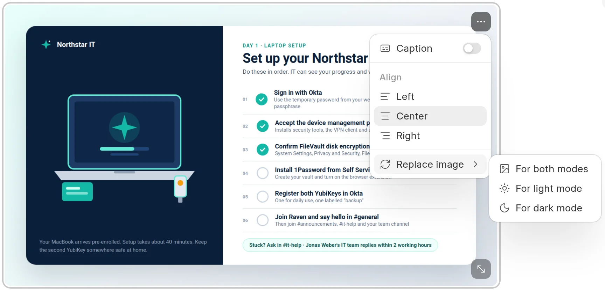

You can add images to a page and give each image a caption, a size, an alignment and a separate version for dark mode.

## Add an image

Use one of these ways:

- Click **Insert Image** in the toolbar, then pick a file.
- Type `/image`, press `Enter`, then pick a file.
- Paste an image from the clipboard.
- Drag an image file onto the page.

The image shows at once with **Uploading…** on it. When the upload is done, the image is saved with the page. If the upload fails, the image shows **Upload failed** and the error. Remove the image and try again.

Images in content that you paste from Google Docs, Notion or a web page are uploaded too.

:::note
You cannot submit a change request while an upload is in progress, or while a failed upload is still on the page.
:::

## Captions, size and alignment

Click an image to select it. Two buttons show on the image.

<picture>
  <source srcset="../images/authoring-content/image-menu-dark.webp" media="(prefers-color-scheme: dark)">
  
</picture>

- **Image options** (top right) opens a menu:
  - **Caption** shows or hides the caption field below the image. Type the caption in **Add a caption**.
  - **Align** sets the image to **Left**, **Center** or **Right**.
  - **Replace image** uploads a new file. See the next section.
- **Resize image** (bottom right). Drag it to change the width. You can also focus it and press the arrow keys to change the width in steps of 20 pixels.

A new image that you upload shows the caption field at once.

## A dark mode version

Screenshots taken in light mode can look wrong in dark mode. You can give an image a second file for dark mode.

1. Select the image and click **Image options**.
2. Click **Replace image**, then **For dark mode**.
3. Pick the file.

The other items in **Replace image** are **For both modes**, **For light mode** and **Remove dark mode image**. **For both modes** removes the dark mode version.

The editor shows the version for the current theme. Readers see the dark version when the wiki is in dark mode, and the light version at all other times. See [Light and dark mode](../reading/light-and-dark-mode.md).

## Alt text

Alt text describes the image for screen readers. The editor has no field for it. Images that you upload have no alt text. To add alt text, paste the image as Markdown with the text in the square brackets, or set it in the Markdown file if the space [syncs from GitHub](../github-sync/images-and-links.md).

## Markdown form

A plain image with a caption:

```markdown

*The setup card in the laptop box*
```

An image with a dark version, a width or an alignment is saved as a `<picture>` block:

```html
<picture>
  <source srcset="/files/setup-dark.png" media="(prefers-color-scheme: dark)">
  
</picture>
*The setup card in the laptop box*
```

## Automatic WebP conversion

The wiki can convert uploaded PNG and JPEG images to WebP to make pages smaller. The setting is on by default. A Wiki Manager can change it in **Settings** > **General** > **Auto Convert Image to WebP**. See [Wiki settings](../administration/wiki-settings.md).

The conversion applies to new uploads only. If a file cannot be converted, the wiki keeps the original file.

## On the published page

Readers can click an image to see it at full size.
