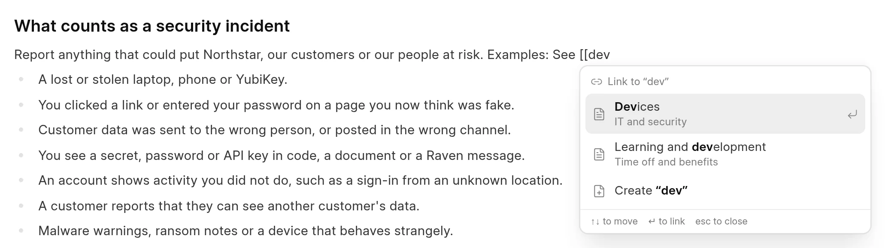

You can link to another page in the same space, or to any web address. A link to a page in the space keeps working when the page moves or gets a new route.

## Link to a page in the space

1. Type `[[` in the text. The **Link to a page** list opens.
2. Type a part of the page title to filter the list.
3. Use the arrow keys and press `Enter`, or click the page.

<picture>
  <source srcset="../images/authoring-content/page-link-picker-dark.webp" media="(prefers-color-scheme: dark)">
  
</picture>

The editor adds the page title as the link text. You can change the text after that. The list shows the group of each page below its title, and an **Unpublished** tag on pages that readers cannot see. It does not show the page you are editing.

Other ways to open the same list:

- Type `/` and pick **Link to Page**.
- Type the exact title between double brackets, for example `[[Devices]]`. The editor links it when you type the closing brackets. Capital letters do not matter.

To point a link at a different page, put the cursor in the link or at its end and press `Backspace`. The link changes back to `[[` and its text, and the list opens again.

## Create a page from a link

If no page has the title you typed, the list shows **Create** and the title. Pick it to add a new draft page with that title, in the same group as the page you are editing. The editor links to the new page when it is created. The new page is part of your change request.

## How page links work

The editor saves a page link with the key of the page, not its route: `[Devices](wiki:2557e41ff475)`. Every page has a key that does not change. When a reader opens the page, the wiki puts in the current route of the linked page. So the link keeps working when you move the page, change its route or change its title.

If the linked page is deleted, unpublished, or only exists in a change request that is not merged yet, readers see the link text without a link.

Page links work only in the same space. To link to a page in another space, use its web address.

## Link to a web address

1. Select the text for the link.
2. Press `Ctrl` + `K` (`Cmd` + `K` on a Mac), or click **Link** in the toolbar.
3. Type or paste the address and press `Enter`.

If the address has no protocol, the editor adds `https://`. Addresses that start with `/` or `#` stay as they are.

## Open, change or remove a link

Put the cursor in a link and press `Ctrl` + `K`. A small window shows the address, or the page title for a page link. It has **Copy**, **Edit** and **Remove**.

To open a link from the editor, hold `Ctrl` (`Cmd` on a Mac) and click it. A page link opens the page in the editor.
