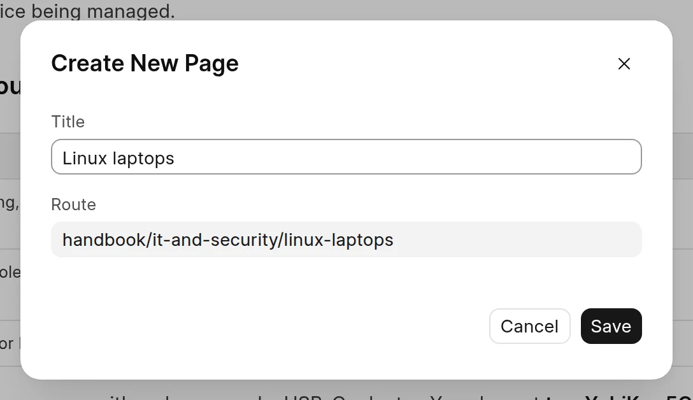
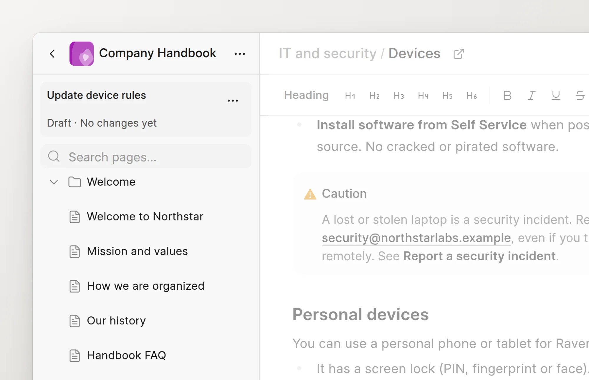

The page tree in the sidebar shows the pages and groups of the space. A group holds pages and other groups, and has no content of its own. All the changes on this page go into your change request, like edits to page content.

The tree actions show only in edit mode. First open a page and click **Edit**. See [Edit a page](edit-a-page.md). In a space with no pages, **New page** shows at once.

## Create a page

1. Click **New page** at the bottom of the sidebar. To create the page in a group, click **...** on the group row, then **New Page**.
2. In the **Create New Page** dialog, enter a **Title**.
3. Check the **Route**. See [Routes](#routes).
4. Click **Save**.

<picture>
  <source srcset="../images/authoring-content/create-page-dialog-dark.webp" media="(prefers-color-scheme: dark)">
  
</picture>

The new page opens in the editor with a **Draft** badge. Until the change request is merged, the **Page actions** menu (**...**) of a new page has **Change route** and **Delete Draft**.

## Create a group or an external link

Click **...** next to **New page** at the bottom of the sidebar, or **...** on a group row. Then click:

- **New Group**. The **Create New Group** dialog has the same **Title** and **Route** fields.
- **External Link**. Enter a **Title** and a **URL**, then click **Save**. The URL must start with `http://`, `https://` or `mailto:`. The link shows in the tree and opens the URL.

## Routes

The route is the URL path of the page, for example `handbook/it-and-security/devices`. As you type the title, the dialog fills in the route from the route of the group and the title. You can change it. After you change it, the title no longer updates it.

For a page, the dialog checks the route. If another page already uses it, the dialog shows **This route is already in use**, and you cannot save.

A route stays the same when you change the title or move the page. To change the route of a page later, use [Page settings](page-settings.md).

## Move and reorder pages

In edit mode, drag a page or a group in the tree:

- Drop it between two rows to change the order.
- Drop it on a group to move it into that group.

You cannot drag while the tree shows search results.

<picture>
  <source srcset="../images/authoring-content/tree-drag-dark.webp" media="(prefers-color-scheme: dark)">
  
</picture>

## Rename, publish and delete

Hold the pointer on a row and click **...**:

- For a page: **Change Title**, **Publish** or **Unpublish**, and **Delete**.
- For a group: **New Page**, **New Group**, **External Link**, **Rename** and **Delete**. **Delete** shows only when the group is empty.

An unpublished page shows a crossed-out eye icon in the tree. Readers cannot see it after the change request is merged.

## Delete and restore

When you delete a page, it stays in the tree, crossed out, until the change request is merged. Then the wiki removes it for everyone. To undo the delete before then, click **...** on the row, then **Restore**.

## Change markers

A colored dot next to a row shows that your change request changes it. Hold the pointer on the dot to see the change: **New**, **Modified**, **Deleted** or **Reordered**.

## Find a page

Type in **Search pages...** at the top of the tree. The search matches page titles and routes, and the tree shows a flat list of results. Press `Esc` to clear the search.
