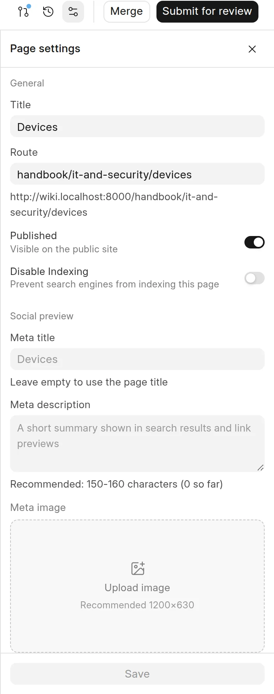

The **Page settings** panel holds the title, route and publish state of a page, its search and social preview fields, and facts about the page.

## Open page settings

1. Open the page in the wiki app.
2. Click **Page settings** (the settings icon) at the top right of the page.
3. Change the fields.
4. Click **Save** at the bottom of the panel.

<picture>
  <source srcset="../images/authoring-content/page-settings-dark.webp" media="(prefers-color-scheme: dark)">
  
</picture>

Nothing changes until you click **Save**. If you open another page first, the panel drops the changes that you did not save.

## General

| Field | What it does |
| :--- | :--- |
| **Title** | The page title. You can also change it in the title at the top of the page. |
| **Route** | The URL path of the page. The full web address shows below the field. |
| **Published** | When on, the page is visible on the public site. |
| **Disable Indexing** | When on, search engines are asked not to index the page. Readers can still open it. |

You cannot clear **Title** or **Route**. If you leave either one empty, the wiki keeps the old value. A `/` at the start of the route is removed.

## Social preview

| Field | What it does |
| :--- | :--- |
| **Meta title** | The title in search results and link previews. Leave it empty to use the page title. |
| **Meta description** | A short summary for search results and link previews. The hint below the field counts the characters. 150 to 160 characters is recommended. |
| **Meta image** | The image in link previews. Click **Upload image**. The recommended size is 1200 × 630 pixels. Hold the pointer on the image to see **Replace** and **Remove**. |

The **Preview** box shows how a link to the page looks when people share it. If the page has no meta image, the preview can show an image that the wiki makes from the page details. See [Social cards](../seo-and-aeo/social-cards.md) and [Meta tags](../seo-and-aeo/meta-tags.md).

## Details

**Details** shows the number of **Words**, the **Reading time**, when the page was **Last edited** and who it was **Edited by**. A Wiki Manager also sees **View in Desk**, which opens the page record in Desk.

## Which fields go into a change request

The fields save in two different ways:

- **Title**, **Route** and **Published** go into your change request. Readers see the change after the change request is merged. You can change these fields only in edit mode. See [Edit a page](edit-a-page.md).
- **Disable Indexing**, **Meta title**, **Meta description** and **Meta image** save to the page at once, with no review. Only people who can write to the space can change them. They are available in read mode too.

:::caution
Changes to the meta fields and to **Disable Indexing** go live on the public site when you click **Save**. No reviewer checks them first.
:::

## Pages in a GitHub synced space

The repository owns the title, route and publish state of the page. These fields show **From the repo** and you cannot change them. You can still change the meta fields and **Disable Indexing**. See [Sync a space](../github-sync/sync-a-space.md).

## New pages

A page that you create in a change request has no **Page settings** panel until the change request is merged. To change its route before then, click **Page actions** (**...**) at the top right, then **Change route**.

For more about indexing, see [Hide from search engines](../seo-and-aeo/hide-from-search-engines.md).
