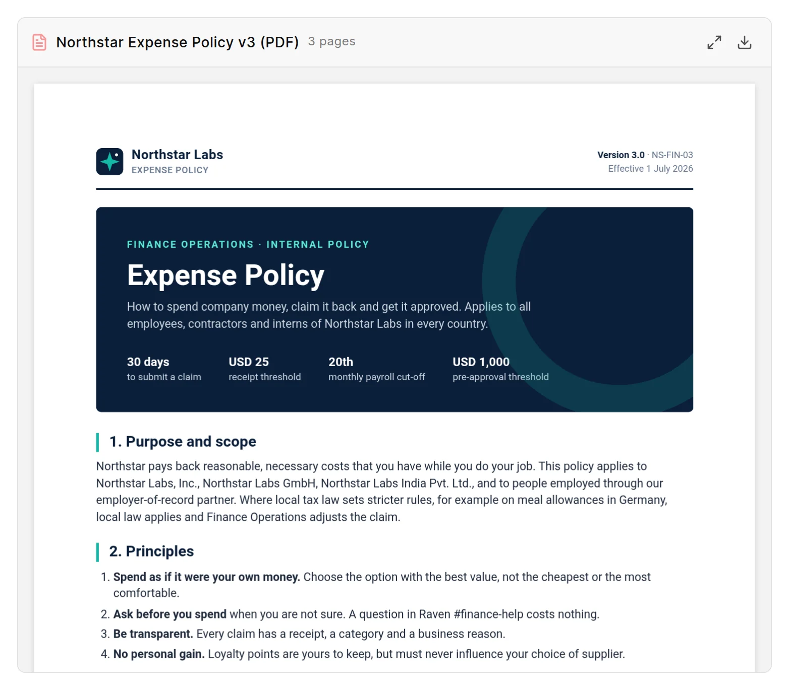

You can add a PDF file or a video file to a page. You can also embed content from sites such as YouTube, Vimeo, Loom, Figma and Google Docs.

## Add a PDF

Use one of these ways:

- Click **Insert PDF** in the toolbar, then pick a file.
- Type `/pdf`, press `Enter`, then pick a file.
- Drag a PDF file onto the page.

The file uploads to your site. You cannot link a PDF from another site.

<picture>
  <source srcset="../images/authoring-content/pdf-card-dark.webp" media="(prefers-color-scheme: dark)">
  
</picture>

The PDF shows as a card. The card header has the file name, the number of pages and these buttons:

- **Open viewer** opens the PDF in a full-screen viewer with **Zoom out**, **Zoom in**, **Download** and **Close**. Press `Esc` to close it.
- **Download** downloads the file.
- **Remove** deletes the card from the page. Only editors see this button.

Below the header, all pages of the PDF show in an area that scrolls. If the wiki cannot draw the PDF, the card shows **Preview unavailable**.

Readers see the same card on the published page, with **Open viewer** and **Download**.

## Add a video file

Use one of these ways:

- Click **Insert Video** in the toolbar, then pick a file.
- Type `/video`, press `Enter`, then pick a file.
- Drag a video file onto the page.

The file uploads to your site. The page shows the video in a player with controls, in the editor and on the published page. The wiki shows files with these extensions as video: `.mp4`, `.webm`, `.ogg`, `.mov`, `.avi`, `.mkv` and `.m4v`. Whether a format plays depends on the browser of the reader.

## Embed content from another site

1. Type `/embed` and press `Enter`.
2. Paste the URL of the page, or the `<iframe>` embed code from the site.
3. Click **Embed**.

You can also paste a supported URL on an empty line. The editor makes the embed for you.

The wiki accepts content from these sites only: YouTube, Vimeo, Loom, CodePen, CodeSandbox, Figma, Framer, Miro, Google Docs and Google Drive, Cloudflare Stream, Bunny Stream, Aparat and GitHub Gist. For other sites, the editor shows an error.

The editor changes share links to embed links. For example, a YouTube watch link becomes an embed link on `youtube-nocookie.com`, which sets no tracking cookies until the reader plays the video.

## Markdown form

A PDF and a video file use the Markdown image form. The file extension tells the wiki what to show:

- A PDF: ``. The text in square brackets is the file name on the card.
- A video: ``.

Put each one on its own line. An embed is saved as an `<iframe>` element.
