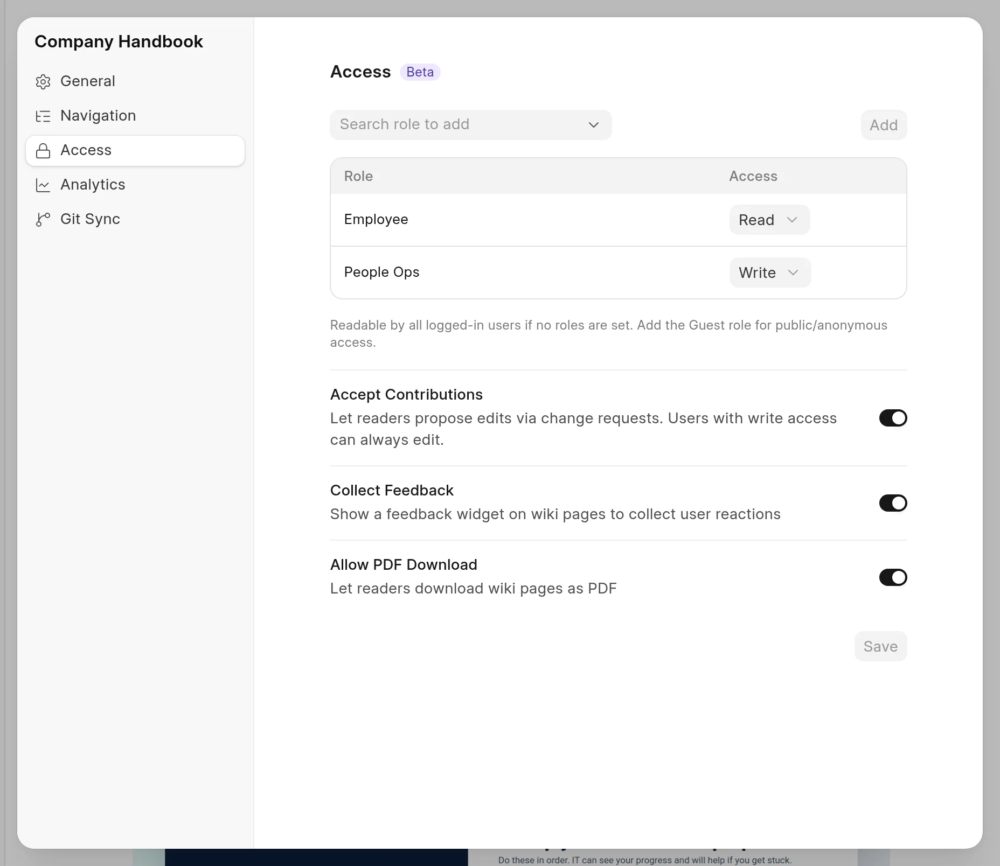
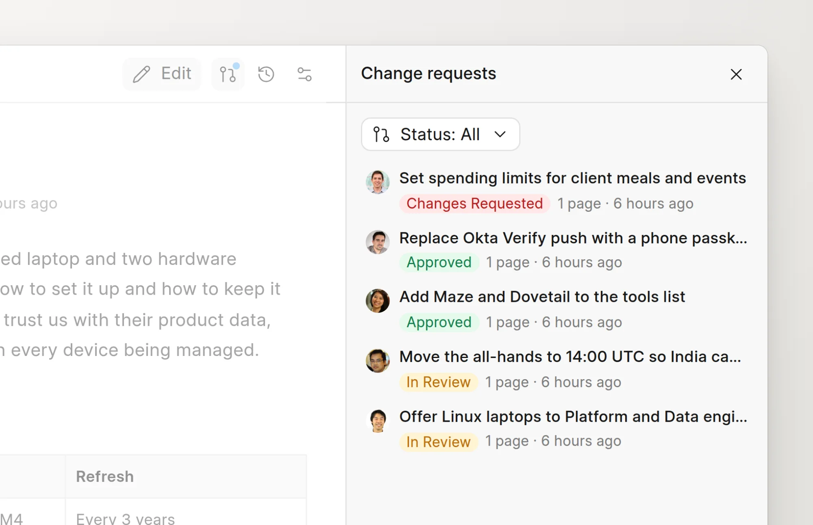

A space can let its readers propose changes. A reader with Read access then creates a change request, and a user with Write access reviews it.

## Turn contributions on or off

Contributions are on for a new space.

1. Open the space.
2. In the sidebar, click **Space actions** (**...**) next to the space name, then click **Space settings**.
3. Click **Access**.
4. Turn **Accept Contributions** on or off.

<picture>
  <source srcset="../images/change-requests/accept-contributions-dark.webp" media="(prefers-color-scheme: dark)">
  
</picture>

You need Write access to the space to change this setting.

When contributions are on:

- Readers with Read access can create and edit change requests in the space.
- The published page shows an **Edit** button to everyone. A visitor who is not logged in must log in first.

When contributions are off:

- Only users with Write access can create change requests in the space.
- The published page shows **Copy** instead of **Edit** to readers.
- The space opens in read mode for readers in the app.

Users with Write access can always edit, whatever the setting.

:::note
Contributions are always off in a space that syncs from GitHub. Its pages are edited on GitHub. See [Edit on GitHub](../github-sync/edit-on-github.md).
:::

## Propose a change as a reader

1. On the published page, click **Edit**. The page opens in the editor.
2. In the **New change request** dialog, enter a **Title** and, if you like, a **Description**.
3. Click **Start editing** and make your changes.
4. Click **Submit for review**, then click **Submit**.

A reader cannot approve or merge. Your change request shows on the **My Change Requests** tab of the **Change Requests** page. You get a notification when a reviewer acts on it. See [Submit for review](submit-for-review.md).

## Review contributions

Contributions go through the same review as all other change requests.

- Open a page in the space and click the change requests icon in the page header. The **Change requests** panel lists the submitted change requests in the space.
- A Wiki Manager sees all of them on the **All in review** tab of the **Change Requests** page.
- To give a contribution to a reviewer, assign it to them. It then shows on their **Assigned to me** tab.

<picture>
  <source srcset="../images/change-requests/space-change-requests-panel-dark.webp" media="(prefers-color-scheme: dark)">
  
</picture>

See [Review a change](review-a-change.md) and [Merge and resolve conflicts](merge-and-resolve-conflicts.md).
