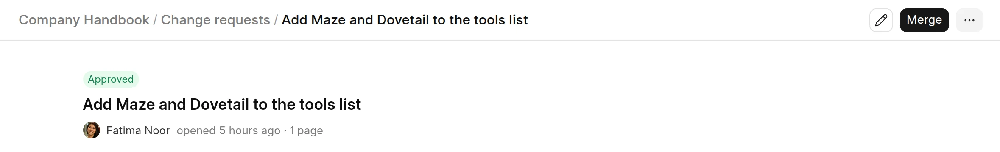
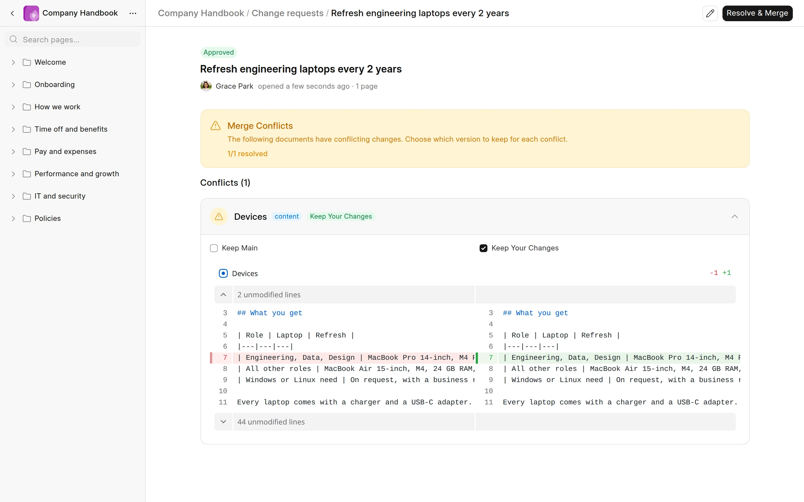

When you merge an approved change request, its changes go live. Wiki also adds a new version to the history of the space.

## Who can merge

To merge, you need Write access to the space and the Wiki Approver role, or the Wiki Manager role.

:::caution[Changes to the page tree]
A Wiki Approver can merge changes to the content of existing pages. A change request that adds, deletes, renames or moves pages, or changes whether a page is published, can only be merged by a Wiki Manager.
:::

## Merge an approved change

1. Open a change request that is `Approved`.
2. Click **Merge**.

The status changes to `Merged` and the changes are live. The author gets a notification.

<picture>
  <source srcset="../images/change-requests/merge-button-dark.webp" media="(prefers-color-scheme: dark)">
  
</picture>

If you can review in the space, you can also merge your own changes from the editor. Click **Merge** in the page header. Wiki submits, approves and merges your change request in one step.

## Outdated change requests

A change request starts from the version of the space at that time. If someone merges other changes to the space later, the change request is outdated.

You can still merge an outdated change request. Wiki combines the two sets of changes:

- Changes to different pages merge without a problem.
- Changes to different lines of the same page also merge.
- Changes to the same part of the same page cause a conflict.

## Conflicts

A conflict occurs when the live space and the change request both changed the same thing. Each conflict has a type:

| Type | Cause |
|---|---|
| `content` | Both changed the same lines of a page, or one deleted a page that the other edited. |
| `meta` | Both changed the same page setting, such as the title, the route or whether it is published. |
| `tree` | Both moved the same page to different places in the page tree. |

When you click **Merge** and Wiki finds conflicts, the change request stays `Approved` and the page shows **Merge Conflicts**.

## Resolve conflicts

1. Click a conflict to expand it. The diff shows the live page on the left and the change request on the right.
2. Select **Keep Main** to keep the live page, or **Keep Your Changes** to use the page from the change request.
3. Do this for each conflict. Wiki selects **Keep Your Changes** by default.
4. Click **Resolve & Merge**.

<picture>
  <source srcset="../images/change-requests/merge-conflicts-dark.webp" media="(prefers-color-scheme: dark)">
  
</picture>

Your choice applies to the whole page. **Keep Main** drops the change of this change request to that page. **Keep Your Changes** replaces the live page, so the other change to that page is lost.

If the space changed again while you resolved the conflicts, Wiki can find new conflicts and shows an error. Reload the page, click **Merge** again, and resolve the conflicts that Wiki shows.

:::note
If a reviewer requests changes, or the author edits an `Approved` change request, Wiki removes its conflicts. Wiki checks for conflicts again at the next merge.
:::
