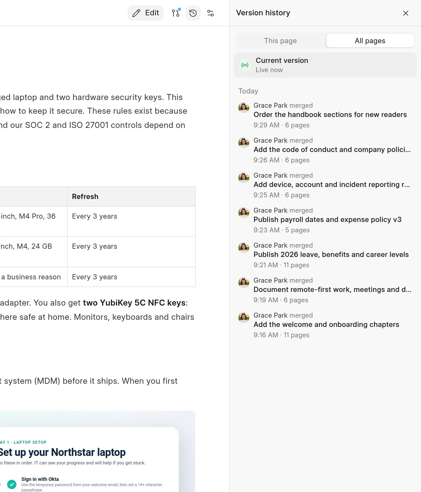
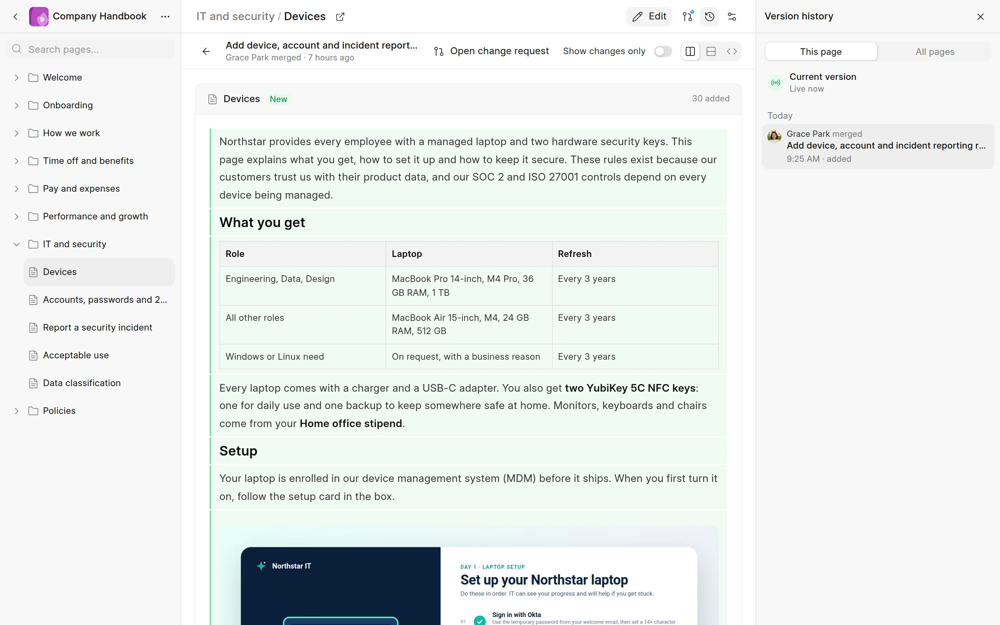

Each merge, Git sync or direct edit in Desk adds a version to a space. The version history shows these versions for one page or for the whole space.

Drafts and change requests that are not merged do not show in the history.

## Open the version history

1. Open a page in the space.
2. In the page header, click **Version history** (the clock icon).

The **Version history** panel opens on the right. Anyone who can read the space can open it.

<picture>
  <source srcset="../images/change-requests/version-history-panel-dark.webp" media="(prefers-color-scheme: dark)">
  
</picture>

## This page and All pages

- **This page** shows each version that changed the open page.
- **All pages** shows each version of the space, with the number of pages it changed.

**Current version** at the top is the page that readers see now. Versions are grouped by date: **Today**, **Yesterday**, **This week** and **Earlier**. To load older versions, click **Show more**.

## What a version shows

Each version shows the person who made it and how:

| Source | Title in the list |
|---|---|
| A merged change request | The title of the change request |
| A Git sync | **Repository sync** |
| A direct edit in Desk | **Direct edit** |
| The first version of the space | **First version** |

On the **This page** tab, each version also lists what changed on the page: added, deleted, renamed, moved, edited, published or unpublished.

## See what a version changed

Click a version. The page shows what that version changed, compared to the version before it. Use the same views as in a review: **Side by side**, **Inline** and **Markdown**, and **Show changes only**. See [Review a change](review-a-change.md).

<picture>
  <source srcset="../images/change-requests/version-diff-dark.webp" media="(prefers-color-scheme: dark)">
  
</picture>

- For a merged change request, click **Open change request** to open its review.
- For a Git sync, click **View commit** to open the commit on GitHub.
- To go back to the live page, click **Back to current version** (the arrow).

## Restore an earlier version

Wiki has no restore action. To undo a change, edit the page and submit a new change request.
