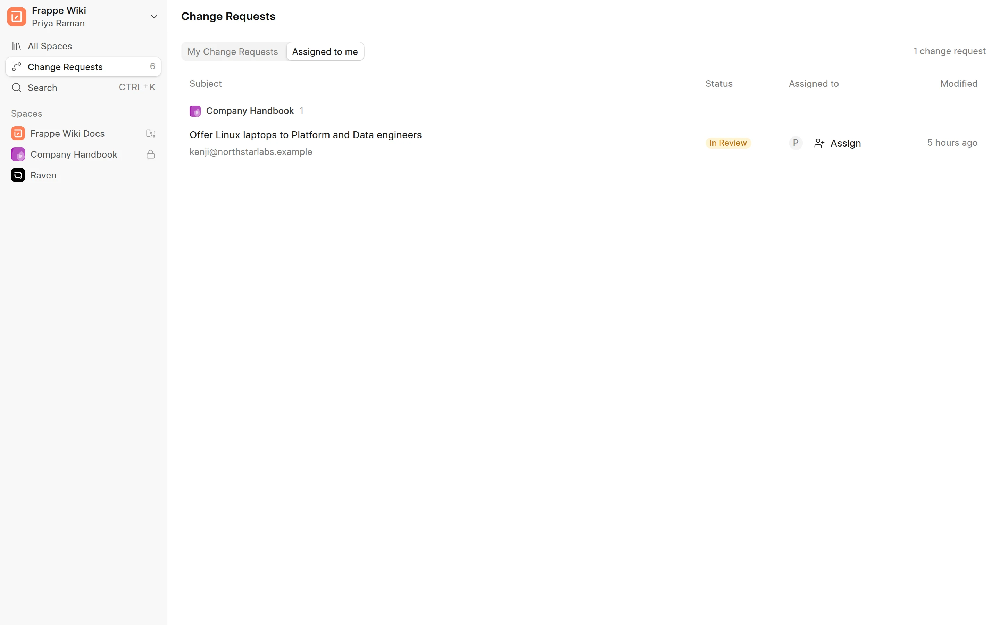

A reviewer reads the changes in a change request, then approves it, requests changes or rejects it.

## Who can review

To review a change request, you need Write access to its space and the Wiki Approver role. A Wiki Manager can review in every space. In a space that has no roles set, every Wiki Approver can review. See [Who can read and write](../spaces/who-can-read-and-write.md).

You can review your own change request.

## Find changes to review

In the sidebar, click **Change Requests**. The page has these tabs:

| Tab | Shows |
|---|---|
| **My Change Requests** | The change requests you created, in all states. |
| **Assigned to me** | The change requests in `In Review` or `Approved` that are assigned to you. |
| **All in review** | All change requests in `In Review` or `Approved`. Only Wiki Managers see this tab. |

<picture>
  <source srcset="../images/change-requests/change-requests-page-dark.webp" media="(prefers-color-scheme: dark)">
  
</picture>

To assign a change request to a reviewer, click **Assign** in its row, select one or more people, then click **Assign**. The people you assign get a notification.

You can also find change requests inside a space. Open a page and click the change requests icon in the page header. The **Change requests** panel lists the submitted change requests in the space. Use the **Status** menu to filter the list.

## Read the changes

Click a change request to open it. The top shows the status, the title, the author, the number of changed pages and the description. Below it, **Changes** shows one card for each changed page.

Use the view switch to pick how you read the changes:

- **Side by side**: the page before the change on the left and after the change on the right.
- **Inline**: one column. Removed text is struck through and added text is green.
- **Markdown**: the Markdown source of the page, before and after.

Turn on **Show changes only** to fold the parts of a page that did not change. This switch is not available in the **Markdown** view.

<picture>
  <source srcset="../images/change-requests/review-side-by-side-dark.webp" media="(prefers-color-scheme: dark)">
  
</picture>

## Approve

Click **Approve**. The status changes to `Approved`. The changes are not live until someone merges them. See [Merge and resolve conflicts](merge-and-resolve-conflicts.md).

To approve and merge in one step, click **More actions** (**...**), then click **Approve & merge**. Click **Approve & Merge** in the dialog to confirm.

## Request changes

1. Click **More actions** (**...**).
2. Click **Request changes**.
3. Enter your **Feedback**. Feedback is required.
4. Click **Request Changes**.

The status changes to `Changes Requested`. The author sees your feedback in the space and can edit and submit again.

## Reject

1. Click **More actions** (**...**).
2. Click **Reject review**.
3. Enter the **Reason**. A reason is required.
4. Click **Reject**.

:::caution
A rejected change request cannot be edited or merged. The author must start a new change request.
:::

The author gets a notification for each decision.
