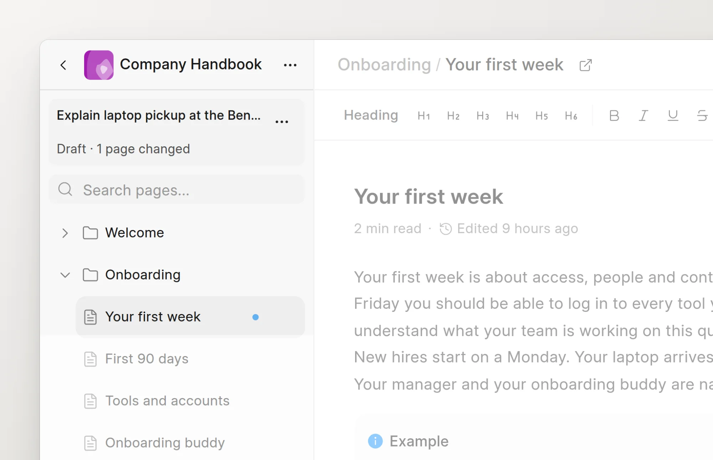
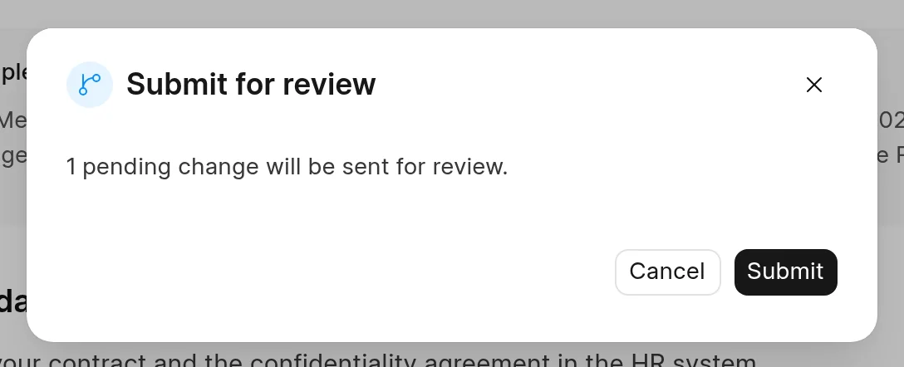
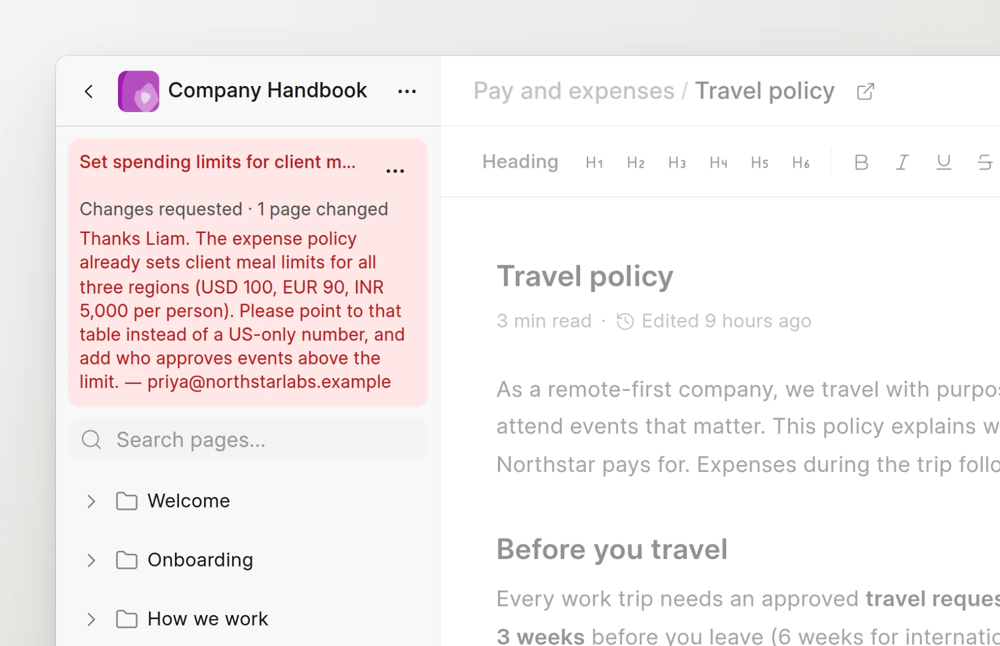

When your changes are ready, submit the change request. A reviewer then approves it, sends it back, or rejects it.

## Start a change request

1. Open a page in the space and click **Edit**.
2. In the **New change request** dialog, enter a **Title**.
3. Enter a **Description**, if you like. Reviewers see it at the top of the review.
4. Click **Start editing**.

In an empty space, Wiki skips the dialog and names the change request "Add initial content".

Your changes save while you type. The sidebar shows a card with the title of the change request, its status and the number of changed pages. To change the title or the description, click the title on the card.

<picture>
  <source srcset="../images/change-requests/draft-card-dark.webp" media="(prefers-color-scheme: dark)">
  
</picture>

## Submit

1. In the page header, click **Submit for review**.
2. The **Submit for review** dialog shows how many changes it sends. If the change request has no title of its own yet, enter a **Title**.
3. Click **Submit**.

<picture>
  <source srcset="../images/change-requests/submit-dialog-dark.webp" media="(prefers-color-scheme: dark)">
  
</picture>

The status changes to `In Review` and the review page opens. The space goes back to read mode for you. Your changes are still not live.

**Submit for review** is not available until all changes are saved and all uploads are complete. Hover over the button to see the reason. You cannot submit a change request that has no changes.

## What happens next

Anyone who can read the space can open your change request and see the changes. A user with Write access to the space reviews it. To ask a specific person, a reviewer or a Wiki Manager can assign it to them. See [Review a change](review-a-change.md).

You get a notification when a reviewer approves, requests changes, rejects or merges your change request.

## Withdraw

You can take back a change request that is `In Review`.

1. Open the change request.
2. Click **Withdraw**.

The status goes back to `Draft`. Open the space to continue to edit.

## Edit after you submit

You can change a change request that is `In Review` or `Approved`.

1. Open the change request.
2. Click the **Edit** button (the pencil icon).
3. Make your changes. They save while you type.
4. Click **Save** to go back to the review.

:::caution
If you edit an `Approved` change request, it goes back to `In Review`. A reviewer must approve it again.
:::

## Changes requested

When a reviewer requests changes, the status changes to `Changes Requested`. Open the space. The sidebar card shows the feedback of the reviewer.

<picture>
  <source srcset="../images/change-requests/changes-requested-card-dark.webp" media="(prefers-color-scheme: dark)">
  
</picture>

Edit the pages, then click **Submit for review** again.

## Discard

To drop a `Draft` or `Changes Requested` change request, click **More actions** on the sidebar card, then click **Discard Changes**. The status changes to `Archived`.
