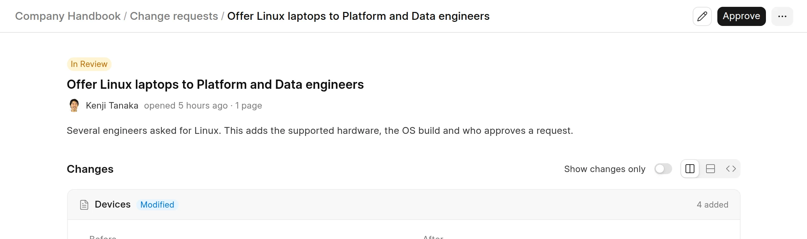
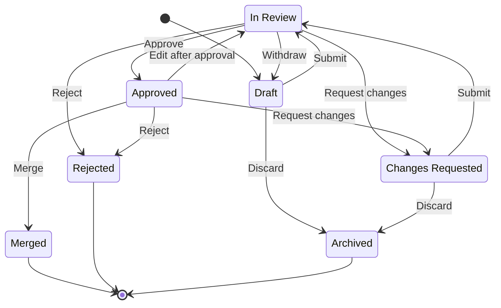

A change request is a set of changes to one space that people review before the changes go live. Readers see the live pages until someone merges the change request.

One change request can add, edit, rename, move and delete many pages in the same space. While you work on it, the change request holds your changes. The live pages do not change.

<picture>
  <source srcset="../images/change-requests/change-request-overview-dark.webp" media="(prefers-color-scheme: dark)">
  
</picture>

## States

Each change request has one status.

| Status | What it means |
|---|---|
| `Draft` | You are still making changes. Only you can see it. |
| `In Review` | You submitted it. It waits for a reviewer. |
| `Changes Requested` | A reviewer sent it back with feedback. You can edit it again. |
| `Approved` | A reviewer approved it. It is not live yet. |
| `Merged` | Someone merged it. The changes are live. |
| `Rejected` | A reviewer rejected it. It cannot be merged. |
| `Archived` | The author discarded it. |

`Merged`, `Rejected` and `Archived` are final. You cannot edit or reopen a change request in these states. To try again after a rejection, start a new change request.

## Who can do what

Your access to the space decides what you can do. See [Who can read and write](../spaces/who-can-read-and-write.md) and [Roles and permissions](../introduction/roles-and-permissions.md).

| Status | Author | Reviewer (Write access) | Other readers |
|---|---|---|---|
| `Draft` | Edit, submit, discard | Cannot see it | Cannot see it |
| `In Review` | Edit, withdraw | Edit, approve, request changes, reject, assign a reviewer | View the changes |
| `Changes Requested` | Edit, submit again, discard | View the changes | View the changes |
| `Approved` | Edit (goes back to `In Review`) | Merge, edit, request changes, reject, assign a reviewer | View the changes |
| `Merged`, `Rejected` | View | View | View |
| `Archived` | View | Cannot see it | Cannot see it |

A Wiki Manager can see and act on every change request.

:::note
If you can approve changes in a space, you can also approve and merge your own change request. Wiki does not require a second person.
:::

## Next steps

- [Submit for review](submit-for-review.md)
- [Review a change](review-a-change.md)
- [Merge and resolve conflicts](merge-and-resolve-conflicts.md)
- [Page history](page-history.md)
- [Contributions from readers](contributions-from-readers.md)
