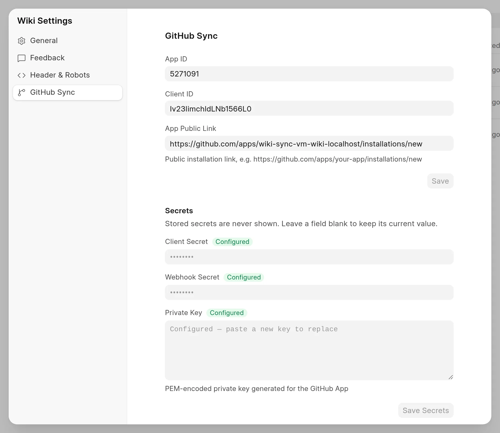
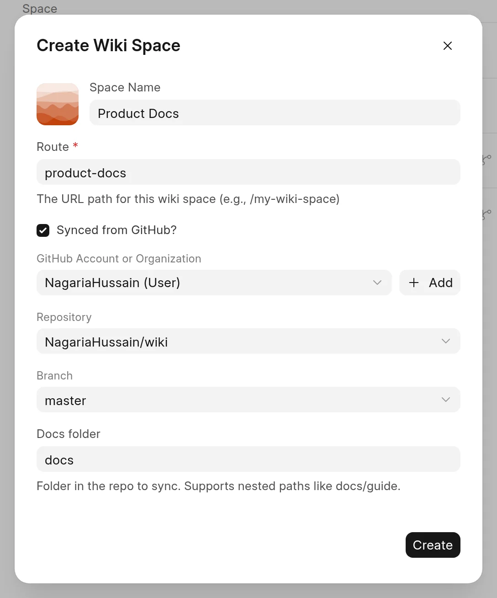

GitHub Sync gets the pages of a space from a folder of Markdown files in a GitHub repository. The sync goes one way: from GitHub to the wiki. To use it, a site admin sets up a GitHub App one time. Then a Wiki Manager connects a repository when they create a space.

## Set up the GitHub App

A Wiki Manager or a System Manager does this one time for the site. The wiki uses the App to read repositories, private ones too. It makes a short-lived access token for each sync and does not store it.

1. In the sidebar, click **Frappe Wiki** at the top, then click **Settings**.
2. Click the **GitHub Sync** tab.
3. Click **Create GitHub App**.
4. On GitHub, keep or change the App name, then create the App.

<picture>
  <source srcset="../images/github-sync/github-app-settings-dark.webp" media="(prefers-color-scheme: dark)">
  
</picture>

GitHub sends you back to the wiki, and the settings open on the **GitHub Sync** tab again. The wiki fills in **App ID**, **Client ID**, **App Public Link** and the three secrets for you. **Create GitHub App** shows only until an App is set up.

The App gets read access to repository contents and metadata only. To create the App under a GitHub organization, open `/github/new_app?org=<organization>` on your site instead of step 3.

:::note[Sites that GitHub cannot reach]
GitHub only sends push events to a public address. If your site runs on `localhost` or on a private network, the App is created with its webhook turned off. Use **Sync now** until the site is public. Then, in the App settings on GitHub, set the webhook URL to `https://<your-site>/api/method/wiki.api.github.webhook`, turn the webhook on and subscribe to the **Push** event.
:::

### Use an App that you made yourself

You can also make the App on GitHub and copy its details into the **GitHub Sync** tab:

- **App ID**, **Client ID** and **App Public Link** (the install link, for example `https://github.com/apps/your-app/installations/new`). Click **Save**.
- **Client Secret**, **Webhook Secret** and **Private Key** (the PEM file). Click **Save Secrets**.

The wiki never shows a stored secret. A **Configured** badge tells you that a value is set. Leave a field empty to keep its current value.

Give the App read access to **Contents** and **Metadata**. Set its callback URL to `https://<your-site>/github/redirect`, and its webhook URL to `https://<your-site>/api/method/wiki.api.github.webhook`.

## Connect a repository to a new space

You connect a repository when you create the space. You cannot connect or disconnect one later.

1. In the sidebar, click **New Space**.
2. Enter a **Space Name** and a **Route**.
3. Select **Synced from GitHub?**.
4. If you have not connected your GitHub account yet, click **Connect GitHub** and approve the access in the window that opens. You do this one time.
5. In **GitHub Account or Organization**, pick the account that has the repository.
6. In **Repository**, search for the repository and pick it.
7. In **Branch**, keep the default branch or pick another one.
8. In **Docs folder**, enter the folder that holds the Markdown files. The default is `docs`. Leave it empty to use the whole repository.
9. Click **Create**.

<picture>
  <source srcset="../images/github-sync/new-space-github-dark.webp" media="(prefers-color-scheme: dark)">
  
</picture>

The wiki makes sure that the branch exists, creates the space and opens it. The first sync starts at once. See [Sync a space](sync-a-space.md).

If the App is not on any account yet, the dialog shows **Install GitHub App**. Click it, and install the App on the account and the repositories that you want to sync. To add another account or organization later, click **Add** next to **GitHub Account or Organization**.

For the other fields in the dialog, see [Create a space](../spaces/create-a-space.md). To learn how the files become pages, see [Folder structure and .wiki.yml](folder-structure.md).
