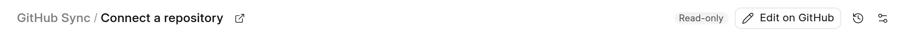

The pages of a synced space come from GitHub, so you change them on GitHub. Each synced page has a button that opens its source file in the GitHub editor.

## Edit a page

1. Open the page in the wiki app or on the published site.
2. Click **Edit on GitHub** in the wiki app, or **Edit** on the published page.
3. GitHub opens the file in a new tab. Make your change and commit it.

<picture>
  <source srcset="../images/github-sync/edit-on-github-dark.webp" media="(prefers-color-scheme: dark)">
  
</picture>

The button opens this URL:

```
https://github.com/<owner>/<repository>/edit/<branch>/<path to the file>
```

The wiki shows your change after the next sync. If the GitHub App has a working webhook, the push starts the sync. Else, click **Sync now**. See [Sync a space](sync-a-space.md).

## Who can use it

On the published site, the **Edit** button shows for every reader, also when they are not signed in. The wiki does not check roles for it. GitHub decides what each person can do:

- People with write access to the repository can commit to the branch.
- Other people can fork the repository and open a pull request.

## Groups

A group opens the `README.md` or `index.md` of its folder. A group that has no such file has no source to edit, so it has no edit button. A group from the `items` of a sidebar config file has no file either. See [Folder structure and .wiki.yml](folder-structure.md).
