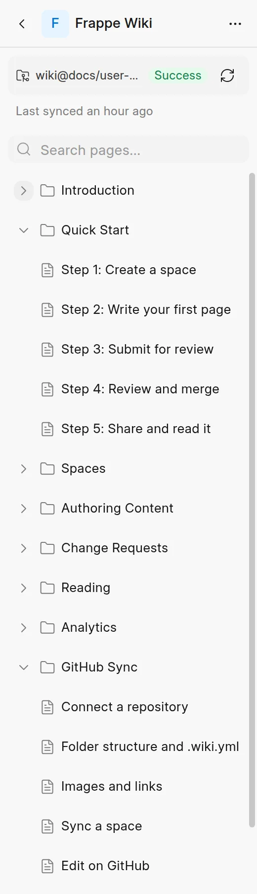

GitHub Sync reads the Markdown files in the docs folder and makes a page tree from them. By default, the folders make the tree. A sidebar config file lets you set the tree yourself.

## What the sync reads

- Files that end in `.md` or `.mdx` become pages. Other files are not pages, but the sync imports the images that pages use. See [Images and links](images-and-links.md).
- Only files in the **Docs folder** of the space are read.
- Files and folders whose name starts with a dot, such as `.github`, are skipped.

## The tree from your folders

When the docs folder has no sidebar config file, the sync makes the tree like this:

- Each folder becomes a group in the sidebar.
- Each Markdown file becomes a page in its folder's group.
- A `README.md` or `index.md` in a folder is not a separate page. It holds the content of the folder's group.
- A `README.md` or `index.md` at the top of the docs folder is not a page in the sidebar either. The URL of the space opens the first page in the sidebar.
- Pages and groups are in alphabetical order of their file or folder name. A front matter order key changes this. See [Front matter](#front-matter).

Each page gets its title from the first item that it has:

1. The `title` in the front matter.
2. The first `# Heading` in the file.
3. The file name. The sync changes `-` and `_` to spaces and capitalizes each word, so `getting-started.md` becomes **Getting Started**.

A group gets its title from its `README.md` or `index.md` in the same way, else from the folder name.

If the first line of a page is a `# Heading` that is the same as the page title, the sync removes it. The page title shows above the content already.

The URL of a page comes from the file and folder names, not from the title. For example, `docs/guides/install.md` becomes `/<space>/guides/install`. If two pages get the same URL, the sync adds `-2`, `-3` and so on.

<picture>
  <source srcset="../images/github-sync/synced-sidebar-dark.webp" media="(prefers-color-scheme: dark)">
  
</picture>

## Front matter

Front matter is a YAML block between two `---` lines at the top of a file. The sync removes the block from the page content and uses these keys:

| Key | What it does |
| :--- | :--- |
| `title` | The page title. A sidebar config `label` takes priority. |
| `slug` | The last part of the page URL, in place of the file name. |
| `sidebar_position`, `nav_order`, `weight` or `order` | The position among the other pages and groups in the same group. A lower number comes first. Items without a number come after, in alphabetical order. Used only when the tree comes from your folders. |
| `published` or `is_published` | Set to `false` to keep the page unpublished. |
| `draft` | Set to `true` to keep the page unpublished. |

```markdown
---
title: Install the app
sidebar_position: 2
slug: install
---
Body of the page.
```

The sync ignores all other keys. If the YAML is not valid, the sync keeps the block in the page as text.

## The sidebar config file

To set the order, the titles and the groups yourself, add a sidebar config file to the top of the docs folder. Use one of these names:

- `.wiki.yml` or `.wiki.yaml` (YAML)
- `.wiki.json` (JSON)

Use only one file. If the docs folder has more than one, the sync stops with an error. The sync also stops if the file is not valid YAML or JSON.

The file has a `sidebar` list. Paths in it are relative to the docs folder. Each entry has one of these shapes:

```yaml
sidebar:
  # A bare path: a page. Its title comes from front matter, the first heading or the file name.
  - index.md
  # label and page: a page with the title that you give.
  - label: Getting Started
    page: getting-started.md
  # label and items: a group with the entries that you list.
  - label: Guides
    items:
      - guides/install.md
      - guides/configure.md
  # autogenerate: a group with the tree of a folder, made as described above.
  - label: Reference
    autogenerate:
      directory: reference
  # slug: the URL part of a group, in place of its label.
  - label: Tutorial (Build an App)
    slug: tutorial
    items:
      - tutorial/first-steps.md
```

When you use a sidebar config file:

- Only the files that the `sidebar` list names are synced. The sync skips an entry if its file is not in the repository.
- Entries are in the order of the list.
- The URL part of a group comes from its `label`, unless you give a `slug`.
- An `autogenerate` entry without a `label` puts the pages of the folder directly at its position, not in a new group.
- With a `label`, an `autogenerate` group uses the `README.md` or `index.md` of the folder as its content.
- A `README.md` or `index.md` at the top level of the list opens at the URL of the space.

The same list in `.wiki.json`:

```json
{
  "sidebar": [
    "index.md",
    { "label": "Getting Started", "page": "getting-started.md" },
    { "label": "Guides", "items": ["guides/install.md", "guides/configure.md"] },
    { "label": "Reference", "autogenerate": { "directory": "reference" } }
  ]
}
```

To see the config that the last sync used, open **Space settings** > **Git Sync** and expand **Sidebar configuration**.

:::note
A file's path is its identity in the wiki. If you rename or move a file, the next sync deletes the old page and creates a new one.
:::
