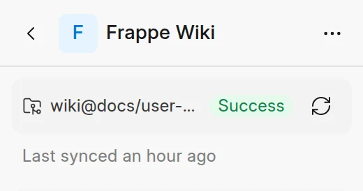

A sync copies the latest commit of the branch into the space. It adds, changes, moves and deletes pages so that the space matches the docs folder in the repository.

## When a sync runs

- **When you create the space.** The first sync starts when the space opens. Until it is done, the space shows "Pulling the latest pages from GitHub".
- **When someone pushes to the branch.** GitHub sends a push event to the wiki, and the wiki syncs each space that uses that repository and branch. The GitHub App must have a working webhook. See [Connect a repository](connect-a-repository.md).
- **When you click Sync now.**

A push to a tag or to another branch does not start a sync. The wiki does not sync on a schedule.

## Sync now

You must have write access to the space.

1. Open the space.
2. In the sidebar, under the space name, click **Sync now** (the refresh icon).

<picture>
  <source srcset="../images/github-sync/sync-strip-dark.webp" media="(prefers-color-scheme: dark)">
  
</picture>

You can also click **...** next to the space name and click **Sync now**, or click **Sync now** in **Space settings** > **Git Sync**.

The badge next to the button shows the state of the last sync: **Sync in progress**, **Success** or **Error**. The line below it shows when the last sync ran. The sidebar loads the new pages when the sync is done.

If the branch has no new commit since the last sync, the sync changes nothing.

## The Git Sync tab

To see the details of a synced space, click **...** next to the space name, click **Space settings**, then click **Git Sync**.

<picture>
  <source srcset="../images/github-sync/git-sync-panel-dark.webp" media="(prefers-color-scheme: dark)">
  
</picture>

| Item | What it shows |
| :--- | :--- |
| **Repository** | The repository and branch, with a link to GitHub, the status of the last sync and **Sync now**. |
| **Docs Folder** | The folder that the pages come from. `/` is the whole repository. |
| **Last Synced** | The time of the last sync and a link to its commit. |
| **Real-time Sync** | The webhook URL for push events. Click the copy icon to copy it. |
| **Sync History** | The last 20 syncs. |
| **Sidebar configuration** | The sidebar config file that the last sync used. See [Folder structure and .wiki.yml](folder-structure.md). |

Each row in **Sync History** shows the status, the time and the commit. A **Webhook** badge tells you that a push started the sync. A successful sync shows what changed: `+` pages created, `~` updated, `-` deleted and `↦` moved. **No Change** means that the branch had no new commit.

## When a sync fails

A failed sync has the **Error** status, and its row in **Sync History** shows the error. Common causes:

- The docs folder has more than one sidebar config file.
- The sidebar config file is not valid YAML or JSON.
- The GitHub App cannot get to the repository, for example after someone removes the App from it.
- The repository is too large for GitHub to list. Set a smaller **Docs folder**.

Fix the cause in the repository, then push or click **Sync now**.

System Managers can also see each sync in Desk at `/app/wiki-git-sync-log`, and each push event that GitHub sent at `/app/wiki-github-webhook-log`. The wiki deletes push event records after 30 days.

## A synced space is read-only

The repository is the source of the content. In the wiki:

- You cannot edit, add, rename, move or delete pages. The editor shows a **Read-only** badge.
- Nobody can open a change request, and **Accept Contributions** stays off.
- To change a page, change the file on GitHub. See [Edit on GitHub](edit-on-github.md).

You cannot turn GitHub Sync on or off for a space after you create it.
