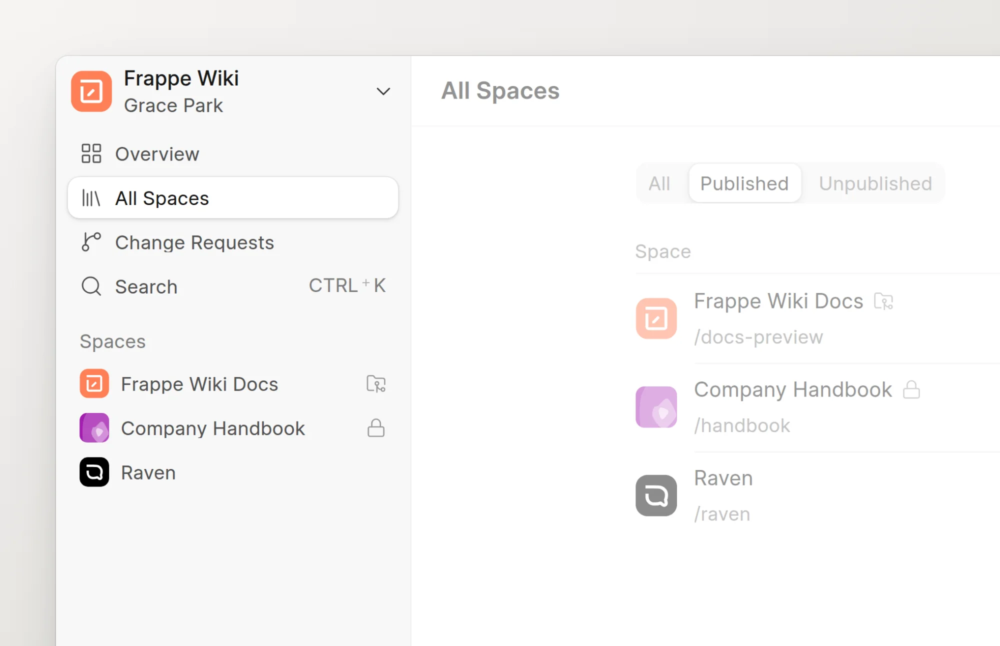
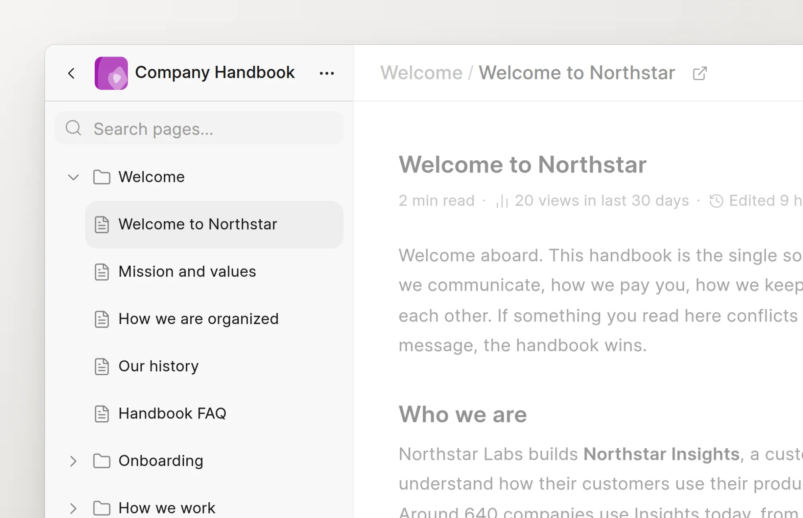

Frappe Wiki has two sides. Writers and reviewers work in the app at `/wiki-app`. Readers read published pages in the reader, at the route of each space.

## The app

Open `/wiki-app` on your site. The sidebar on the left lists everything in the wiki.

<picture>
  <source srcset="../images/introduction/app-sidebar-dark.webp" media="(prefers-color-scheme: dark)">
  
</picture>

- **Overview** shows page views, new visitors, open change requests, top pages and top referrers. Only Wiki Managers and System Managers see it.
- **All Spaces** lists every space you can read, with a search box and a filter for published and unpublished spaces.
- **Change Requests** lists change requests in tabs: **My Change Requests**, **Assigned to me** and, for Wiki Managers, **All in review**.
- **Search** opens the command palette. You can also press `Ctrl+K`, or `Cmd+K` on a Mac. Type to find a page, or to run a command such as **New page** or **Toggle theme**.
- **Spaces** lists the spaces themselves. Right-click a space to pin it to the top, open its settings or copy its link. Wiki Managers also see unpublished spaces, in a separate **Unpublished** section.
- **New Space**, at the bottom, opens the dialog to create a space. Only Wiki Managers and System Managers see it.

The menu at the top of the sidebar has **Settings** (for Wiki Managers), **Toggle Theme** and **Log out**.

## Inside a space

Click a space to open it. The sidebar changes to show that space.

<picture>
  <source srcset="../images/introduction/space-sidebar-dark.webp" media="(prefers-color-scheme: dark)">
  
</picture>

- The arrow at the top left goes **Back to All Spaces**.
- The **⋯** menu next to the space name has **Space settings** and **View live site**.
- The page tree shows the groups and pages of the space. Use **Search pages...** to filter it.
- **New page** at the bottom adds a page. The **⋯** button next to it adds a group or an external link.

When you edit, a card under the space name shows your change request: its title, its status and how many pages it changes. See [Edit a page](../authoring-content/edit-a-page.md).

## The reader

Readers see each space at its own route, for example `/handbook`. A page is at the route of the space plus the route of the page, for example `/handbook/time-off-and-benefits/paid-time-off`.

<picture>
  <source srcset="../images/introduction/reader-dark.webp" media="(prefers-color-scheme: dark)">
  
</picture>

- The page tree is on the left. The **On this page** list of headings is on the right.
- The search field at the top searches all pages in the space.
- The theme button switches between light and dark mode.
- An **Edit** button is next to the title when the space accepts contributions, or when you have write access. It opens the page in the app. A synced page links to its file on GitHub instead.

To open the reader from the app, click **View live site** in the **⋯** menu of the space. See [Browse a space](../reading/browse-a-space.md).
