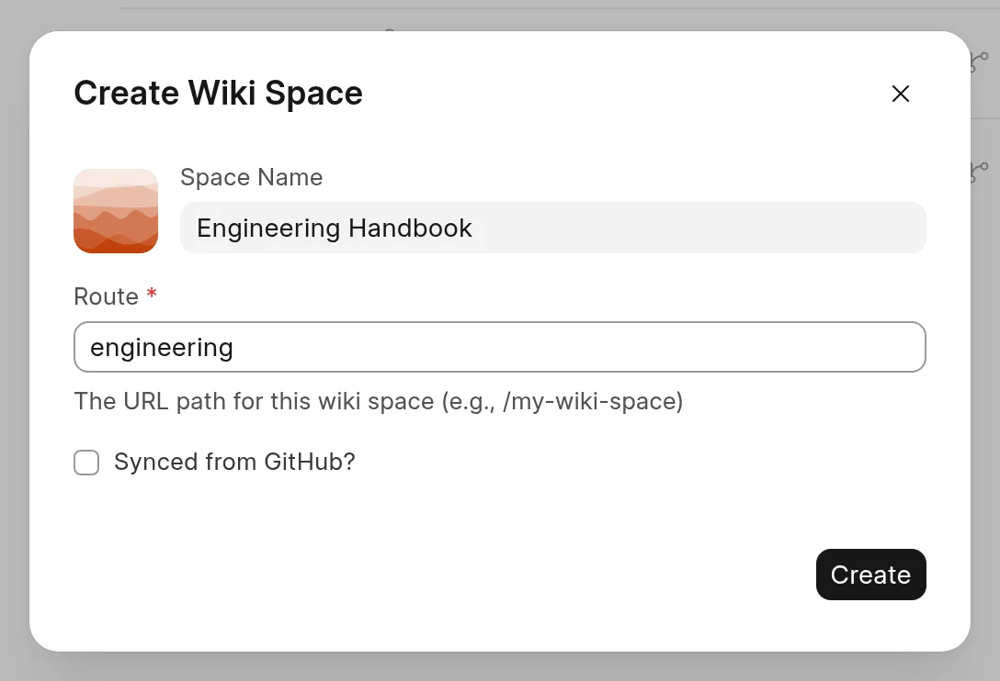
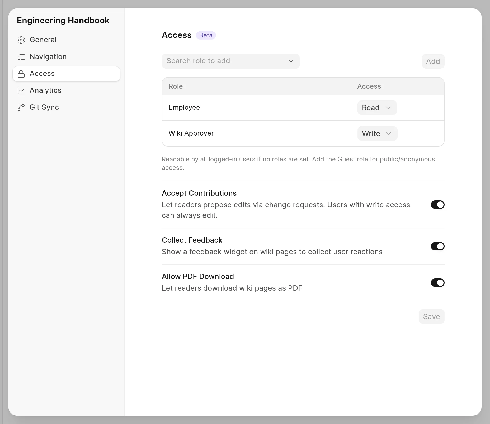

This quick start follows one page from the first draft to the live site. Grace Park is a Wiki Manager at Northstar Labs. She makes a private space for the engineering team, writes a page about deployments, and Priya Raman reviews it.

In this step, Grace creates the space. You need the Wiki Manager or System Manager role to create a space.

## Create the space

1. Open `/wiki-app`.
2. At the bottom of the sidebar, click **New Space**.
3. In **Space Name**, type `Engineering Handbook`. The **Route** fills in from the name.
4. Change **Route** to `engineering`. The space will be at `/engineering` on your site.
5. Click **Create**.

<picture>
  <source srcset="../images/quick-start/create-space-dialog-dark.webp" media="(prefers-color-scheme: dark)">
  
</picture>

The space opens. It has no pages yet.

## Choose who can read it

A new space is open to every signed-in user. Grace wants only employees to read it, and only reviewers to approve changes.

1. In the sidebar, click **⋯** next to the space name, then click **Space settings**.
2. Click **Access**.
3. In **Search role to add**, type `Employee`, select it and click **Add**. Keep its access at **Read**.
4. Add `Wiki Approver` the same way. Set its access to **Write**.
5. Click **Save**.

<picture>
  <source srcset="../images/quick-start/space-access-dark.webp" media="(prefers-color-scheme: dark)">
  
</picture>

Now only users with the Employee role can read the space. Priya has the Wiki Approver role, so she can approve changes. As a Wiki Manager, Grace always has full access.

:::tip
To make a space public, add the `Guest` role with **Read** access.
:::

## More options

The space has more settings, such as its icon, its logo and GitHub sync. See:

- [Create a space](../spaces/create-a-space.md)
- [Space appearance](../spaces/space-appearance.md)
- [Who can read and write](../spaces/who-can-read-and-write.md)

## Next

[Step 2: Write your first page](write-your-first-page.md)
