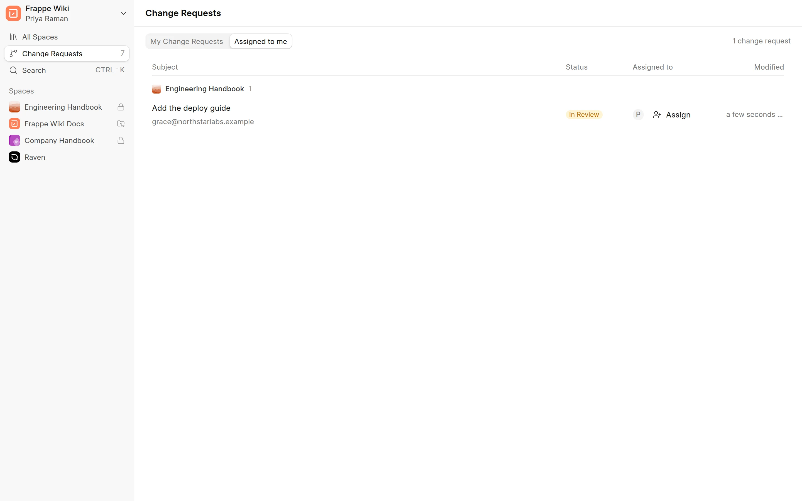
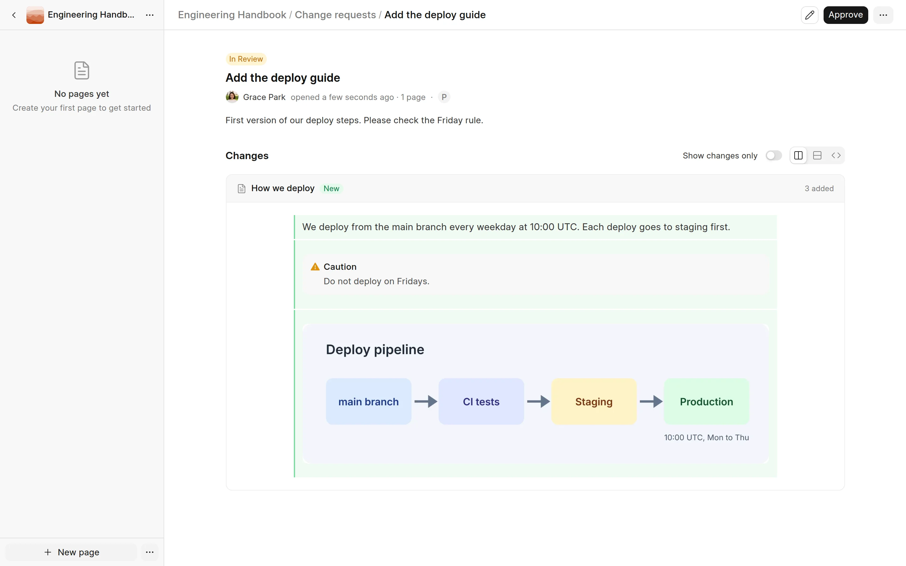

In this step, Priya reads the change and approves it. Then Grace merges it, and the page goes live.

## Priya opens the change request

1. Priya opens `/wiki-app` and clicks **Change Requests** in the sidebar.
2. She clicks the **Assigned to me** tab. **Add the deploy guide** is in the list.
3. She clicks the change request to open its review page.

<picture>
  <source srcset="../images/quick-start/assigned-to-me-dark.webp" media="(prefers-color-scheme: dark)">
  
</picture>

Wiki Managers also have the **All in review** tab. It lists every change request that is in review or approved.

## Priya reads the changes

The review page shows the title, the author, the description and the changed pages. Each page shows a diff of the old and new content.

- **Side by side** shows the old and new text in two columns.
- **Inline** shows the changes in one column.
- **Markdown** shows the Markdown source.
- **Show changes only** hides the parts that did not change.

<picture>
  <source srcset="../images/quick-start/review-page-dark.webp" media="(prefers-color-scheme: dark)">
  
</picture>

## Priya approves

Priya clicks **Approve**. The status changes to **Approved**, and Grace gets a notification.

If the change needs work, Priya clicks **⋯** and then **Request changes**, and writes her feedback. Grace then sees the feedback on the change request card, edits the page and submits again. To decline the change for good, Priya clicks **Reject review**.

## Grace merges

1. Grace opens the change request. It is in **My Change Requests** on the **Change Requests** page.
2. She clicks **Merge**.

The status changes to **Merged**. The page **How we deploy** is now live, and its first version is in the page history.

To merge, you need Write access to the space. See [Merge and resolve conflicts](../change-requests/merge-and-resolve-conflicts.md) for what happens when the page changed after the change request started.

:::tip[On a small team]
Frappe Wiki lets you approve and merge your own change request when you have Write access to the space. A Wiki Manager can click **Merge** at the top of the editor. This submits, approves and merges the change request in one step. It still shows in the history like any other merge.
:::

## Next

[Step 5: Share and read it](share-and-read-it.md)
