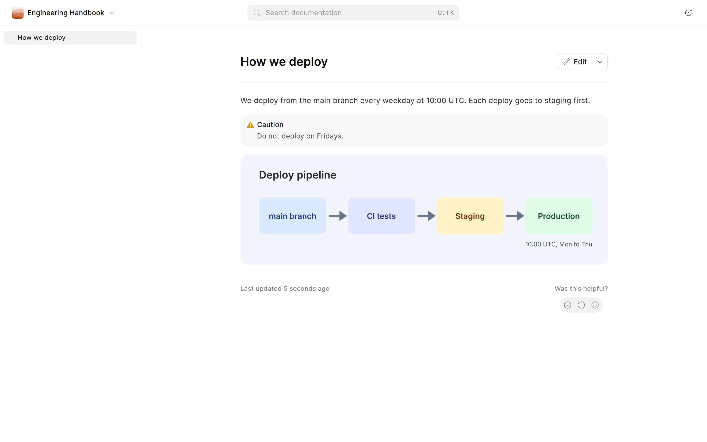
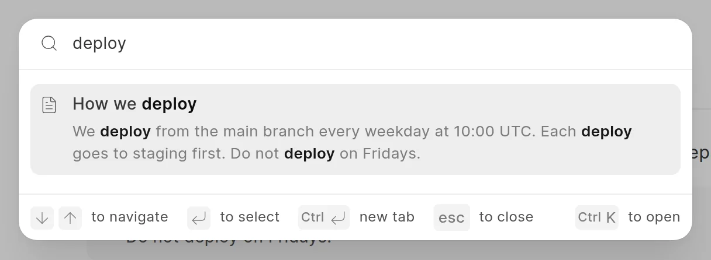

In this step, Grace shares the new page with the engineering team, and they read it.

## Open the live page

The page is live at `/engineering/how-we-deploy` on your site. To open it from the app, do one of these:

- On the page, click the **Open live page** icon next to the page name at the top.
- In the sidebar, click **⋯** next to the space name, then click **View live site**.

Grace copies the URL and sends it to the team.

<picture>
  <source srcset="../images/quick-start/live-page-dark.webp" media="(prefers-color-scheme: dark)">
  
</picture>

## What readers see

The space is private, so readers must sign in to the site first. Then each user with the Employee role can read it. People who are not signed in, and users without the role, get a "not found" page.

- The page tree of the space is on the left.
- The headings of the page are on the right, under **On this page**.
- **Search documentation** at the top finds pages in the space. You can also press `Ctrl+K`, or `Cmd+K` on a Mac.
- The theme button switches between light and dark mode.

<picture>
  <source srcset="../images/quick-start/reader-search-dark.webp" media="(prefers-color-scheme: dark)">
  
</picture>

See [Browse a space](../reading/browse-a-space.md), [Search](../reading/search.md) and [Light and dark mode](../reading/light-and-dark-mode.md).

## Make the space public

To let everyone read the space without signing in, add the `Guest` role with **Read** access in **Space settings** > **Access**. See [Who can read and write](../spaces/who-can-read-and-write.md).

## Where to go next

You made a space, wrote a page, reviewed it and published it. Learn more about each part:

- [Spaces](../spaces/create-a-space.md): appearance, access and the space switcher.
- [Authoring content](../authoring-content/edit-a-page.md): formatting, diagrams, links and page settings.
- [Change requests](../change-requests/what-is-a-change-request.md): review, merge conflicts and page history.
- [Analytics](../analytics/page-views.md): page views and reader feedback.
- [GitHub sync](../github-sync/connect-a-repository.md): keep a space in a repository.
- [SEO and AEO](../seo-and-aeo/meta-tags.md): meta tags, social cards and `llms.txt`.
- [Administration](../administration/wiki-settings.md): wiki settings and translations.
