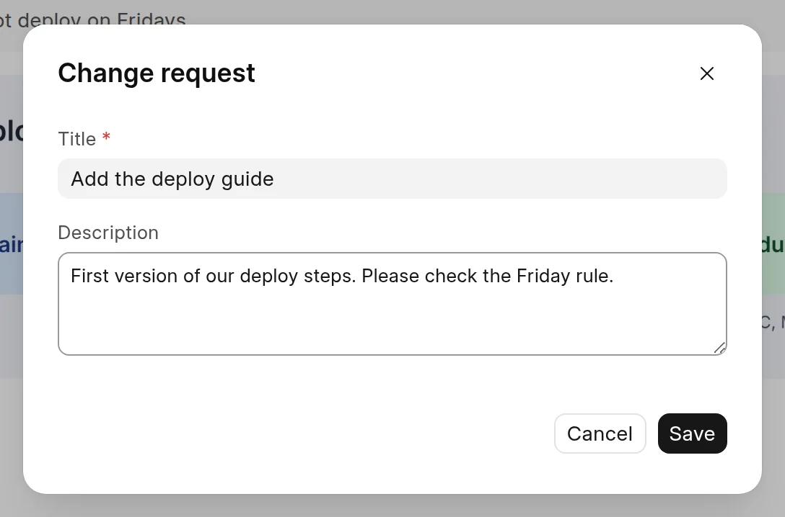
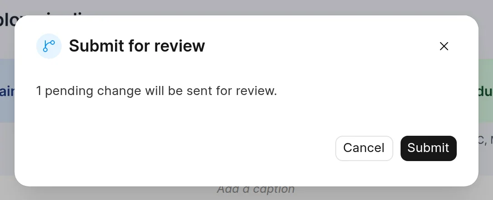
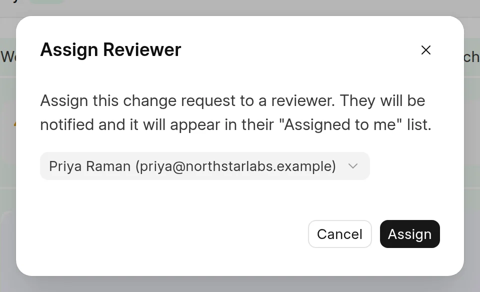

In this step, Grace gives her change request a clear title and sends it for review. Then she asks Priya to review it.

## Give the change request a title

The change request has the title **Add initial content**. A better title tells the reviewer what the change is.

1. In the sidebar, click the title on the change request card.
2. In the **Change request** dialog, change **Title** to `Add the deploy guide`.
3. In **Description**, type what the reviewer must know. For example, `First version of our deploy steps. Please check the Friday rule.`
4. Click **Save**.

<picture>
  <source srcset="../images/quick-start/change-request-details-dark.webp" media="(prefers-color-scheme: dark)">
  
</picture>

## Submit it

1. At the top right of the page, click **Submit for review**.
2. The dialog shows how many changes go to review. Click **Submit**.

<picture>
  <source srcset="../images/quick-start/submit-dialog-dark.webp" media="(prefers-color-scheme: dark)">
  
</picture>

The status changes to **In Review**, and the review page of the change request opens. While a change request is in review, its author can click **Withdraw** to take it back to **Draft**. If the author can also review, **Withdraw** is in the **⋯** menu.

## Ask a reviewer

Submitting does not send the change to a person. To ask a person to review it, assign it to them. You need Write access to the space to assign a reviewer.

1. On the review page, click **⋯** (**More actions**) next to **Approve**.
2. Click **Assign reviewer**.
3. In the **Assign Reviewer** dialog, search for `Priya Raman` and select her.
4. Click **Assign**.

<picture>
  <source srcset="../images/quick-start/assign-reviewer-dark.webp" media="(prefers-color-scheme: dark)">
  
</picture>

Priya gets a notification. The change request also shows in her **Assigned to me** tab on the **Change Requests** page.

For more about this step, see [Submit for review](../change-requests/submit-for-review.md).

## Next

[Step 4: Review and merge](review-and-merge.md)
