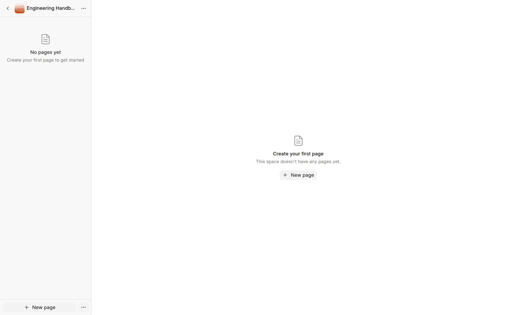
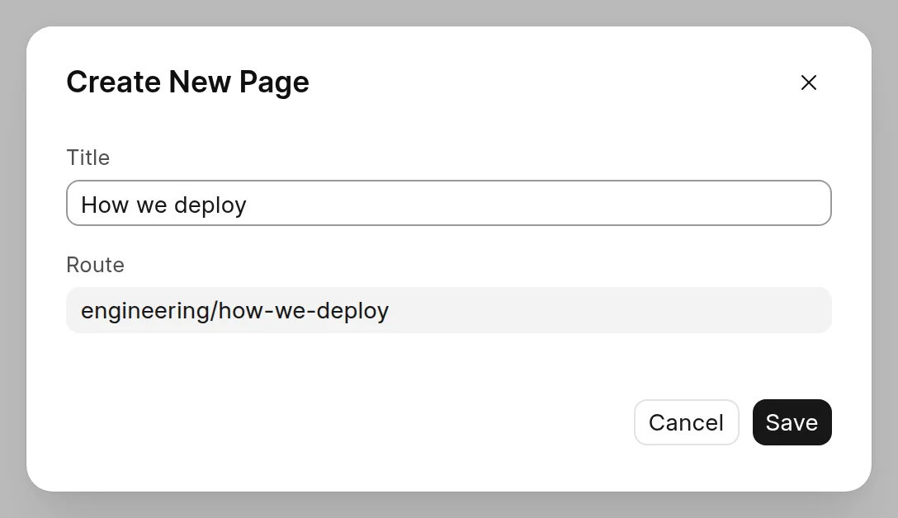
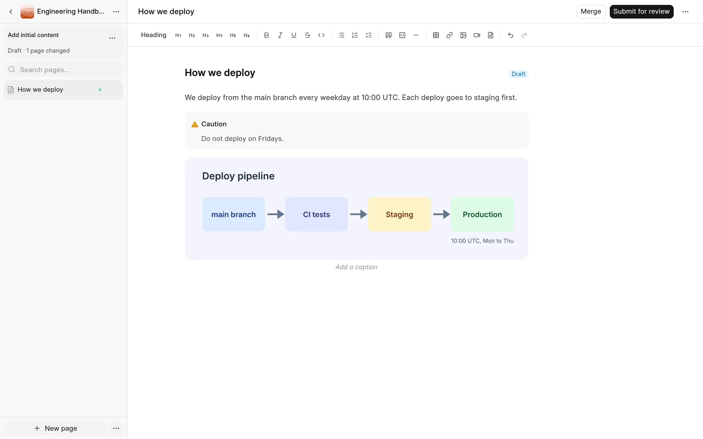
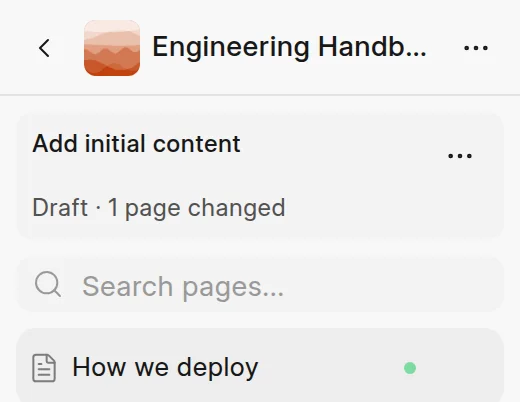

In this step, Grace writes the page **How we deploy** in the Engineering Handbook. Her edits go into a change request, not to the live site.

## Create the page

A new space has no pages. The sidebar says **No pages yet**, and the page area has a **New page** button.

<picture>
  <source srcset="../images/quick-start/empty-space-dark.webp" media="(prefers-color-scheme: dark)">
  
</picture>

1. In the sidebar, click **Engineering Handbook** to open the space.
2. Click **New page**.
3. In **Title**, type `How we deploy`. The **Route** fills in as `engineering/how-we-deploy`.
4. Click **Save**.

<picture>
  <source srcset="../images/quick-start/create-page-dialog-dark.webp" media="(prefers-color-scheme: dark)">
  
</picture>

The page opens in the editor.

In an empty space, Frappe Wiki starts a change request called **Add initial content** for you. In a space that has pages, you click **Edit** first. Then you give your change a title in the **New change request** dialog and click **Start editing**.

## Write the text

Click below the title and type. For example:

`We deploy from the main branch every weekday at 10:00 UTC. Each deploy goes to staging first.`

You can use Markdown shortcuts as you type. For example, `## ` starts a heading and `- ` starts a list.

## Add a callout

1. On a new line, type `/`.
2. Under **Callouts**, click **Warning**.
3. Type `Do not deploy on Fridays.`

## Add an image

1. On a new line, type `/` and click **Image**.
2. Select an image file on your computer, for example a diagram of the deploy pipeline.

The image uploads and shows in the page. You can also click **Insert Image** in the toolbar.

<picture>
  <source srcset="../images/quick-start/page-in-editor-dark.webp" media="(prefers-color-scheme: dark)">
  
</picture>

## Your edits save as you type

You do not need a save button. When you stop typing for a moment, the editor saves your edits to the change request. **Saving…** shows at the bottom of the sidebar while it saves.

The card under the space name shows the change request. It shows its title, its status **Draft**, and how many pages it changes.

<picture>
  <source srcset="../images/quick-start/draft-strip-dark.webp" media="(prefers-color-scheme: dark)">
  
</picture>

Readers do not see the page yet. It goes live only after the change request is merged.

To learn more about the editor, see [Edit a page](../authoring-content/edit-a-page.md), [Callouts](../authoring-content/callouts.md) and [Images](../authoring-content/images.md).

## Next

[Step 3: Submit for review](submit-for-review.md)
