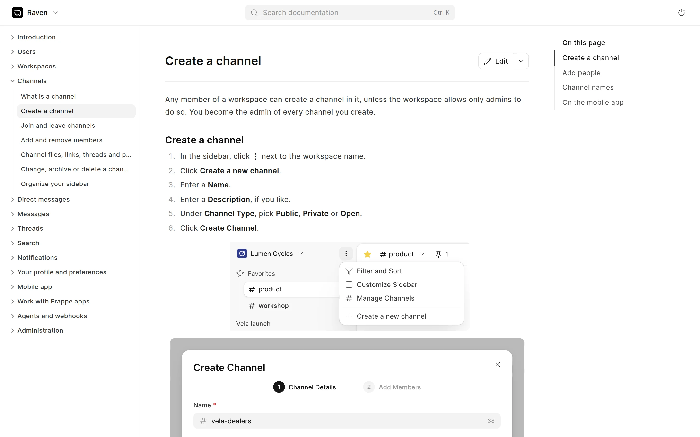
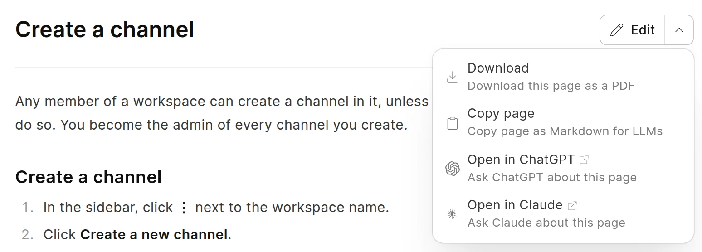
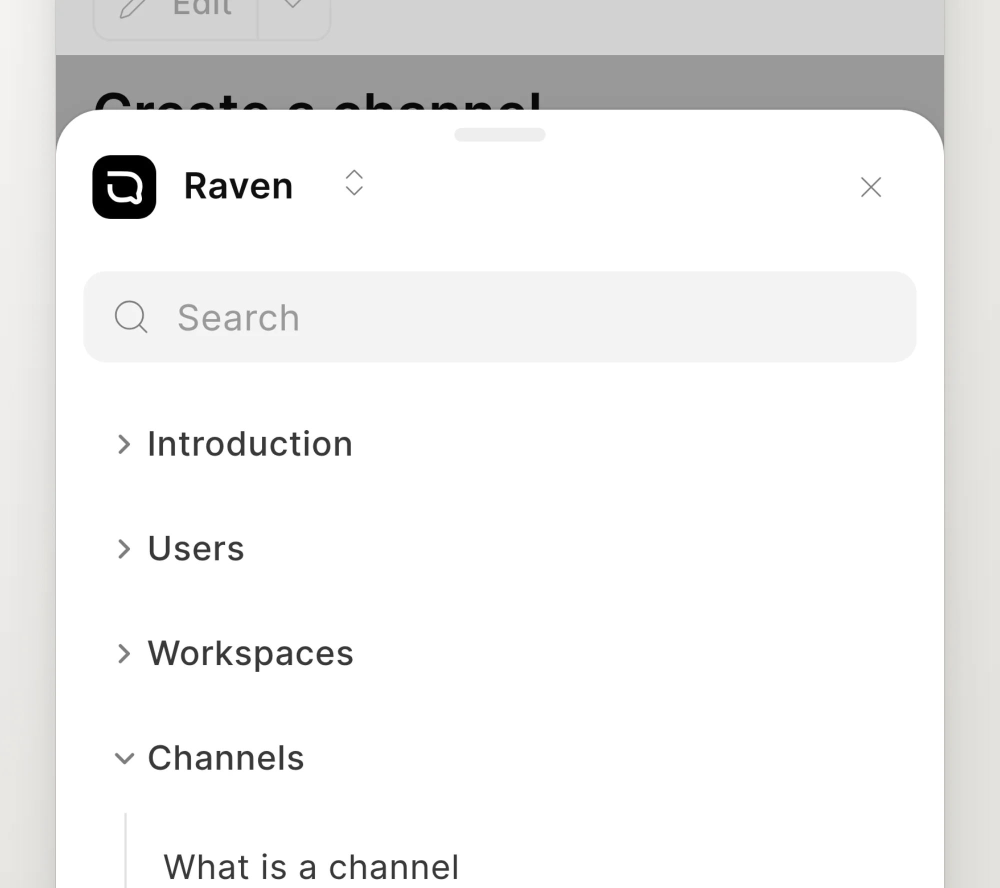

Readers see a space at its route, for example `/raven`. The space route opens the first page in the sidebar.

<picture>
  <source srcset="../images/reading/reader-page-dark.webp" media="(prefers-color-scheme: dark)">
  
</picture>

## The parts of a page

- **Header**: the space mark and name, the space switcher, the search field, the theme toggle and the links of the space.
- **Sidebar**: the pages and groups of the space. Click a group to open or close it. The current page is highlighted.
- **Page**: the title, the page actions and the content.
- **On this page**: the H2 and H3 headings of the page. Click a heading to go to it. The current heading is highlighted as you scroll. A Wiki Manager can turn it off for all spaces with **Enable Table of Contents** in [Wiki settings](../administration/wiki-settings.md).

Below the content are links to the previous and the next page, in sidebar order. Below them is the **Last updated** time and, if the space collects feedback, **Was this helpful?**. See [Give feedback](give-feedback.md).

Move the pointer over a heading to see a `#` link. Click it to get a link to that heading.

:::tip[Keyboard shortcut]
Press `S` to hide or show the sidebar. You can also click the arrows at the edge of the sidebar.
:::

## Page actions

The button next to the page title has these actions:

| Action | When it shows | What it does |
| :--- | :--- | :--- |
| **Edit** | The space accepts contributions, or you have write access. | Opens the page in the editor. On a GitHub-synced space, it opens the file on GitHub. |
| **Copy** | Instead of **Edit**, when you cannot edit. | Copies the page as Markdown. |
| **Download** | The space allows PDF download. | Saves the page as a PDF. See [Download as PDF](download-as-pdf.md). |
| **Copy page** | You can edit. | Copies the page as Markdown. |
| **Open in ChatGPT**, **Open in Claude** | The space is public. | Opens a chat that asks about this page. |

The actions other than **Edit** and **Copy** are in the menu. Click the arrow at the right of the button to open it.

<picture>
  <source srcset="../images/reading/page-actions-dark.webp" media="(prefers-color-scheme: dark)">
  
</picture>

See [Edit a page](../authoring-content/edit-a-page.md) and [Contributions from readers](../change-requests/contributions-from-readers.md).

## On a phone

On a small screen, the reader changes its layout:

- The header shows the space mark and name, the links of the space, a search button and a theme button.
- **On this page** is a bar under the header. Tap it to see the headings.
- The sidebar is hidden. Tap **Menu** at the bottom right to open it from the bottom of the screen. It has the space switcher, a **Search** field that filters the pages, and the links of the space.
- The page actions button is above the title.

To close the menu, tap outside it, tap the close button, or drag it down.

<picture>
  <source srcset="../images/reading/mobile-menu-dark.webp" media="(prefers-color-scheme: dark)">
  
</picture>
