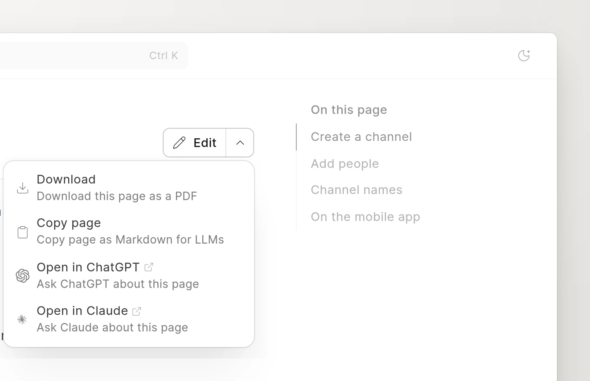
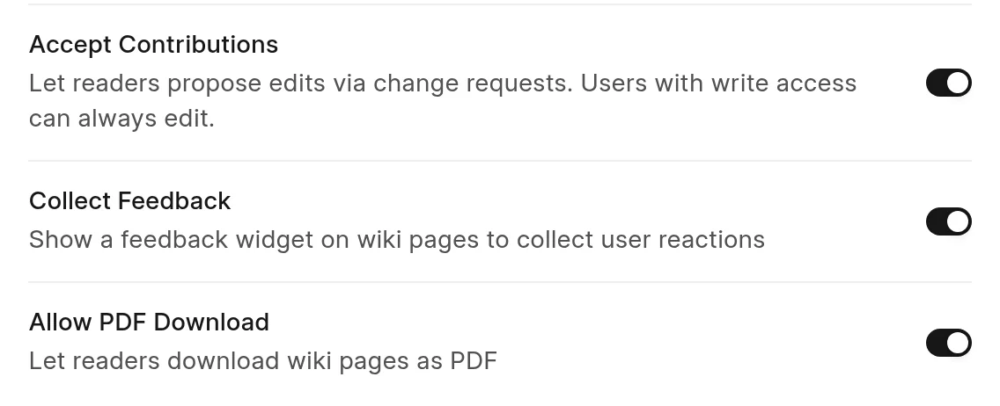

Readers can save a page of a space as a PDF file, if the space allows it.

## Download a page

1. Open the page in the reader.
2. Click the arrow at the right of the button next to the page title.
3. Click **Download**.

<picture>
  <source srcset="../images/reading/download-pdf-dark.webp" media="(prefers-color-scheme: dark)">
  
</picture>

The item shows **Preparing…** while the wiki makes the file. Then the browser saves it. The file name is the last part of the page URL, for example `create-a-channel.pdf`.

On a phone, the button is above the page title.

## What the PDF contains

- The space name and the groups above the page.
- The page title.
- The **Last Updated** date.
- The page content.

The PDF does not have the sidebar, the header or the feedback widget.

## Turn PDF download on or off

**Allow PDF Download** is on for new spaces. You must have write access to the space to change it.

1. Open the space, click **...** next to its name, and click **Space settings**.
2. Click **Access**.
3. Turn **Allow PDF Download** on or off.

<picture>
  <source srcset="../images/reading/allow-pdf-setting-dark.webp" media="(prefers-color-scheme: dark)">
  
</picture>

When it is off, the reader does not show **Download**, and the server refuses PDF requests for the pages of the space.

:::note
A reader can download only pages that they can read. Groups and external links have no PDF.
:::
