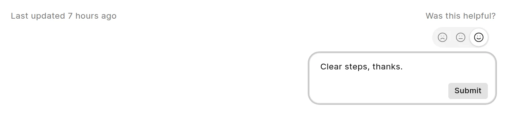

Readers can rate a page and add a comment. The feedback goes to the people who run the wiki.

## Rate a page

1. Go to the bottom of the page. Find **Was this helpful?**.
2. Click a face: **Bad**, **Ok** or **Good**.
3. Type a comment in the box, if you like.
4. Click **Submit**.

<picture>
  <source srcset="../images/reading/feedback-widget-dark.webp" media="(prefers-color-scheme: dark)">
  
</picture>

The widget shows **Thanks!** when the wiki has your feedback. You do not need to log in.

Each submission stores the page, the rating and the comment. See [Reader feedback](../analytics/reader-feedback.md) to find out where managers see it.

## Turn feedback on or off for a space

**Collect Feedback** is on for new spaces. You must have write access to the space to change it.

1. Open the space, click **...** next to its name, and click **Space settings**.
2. Click **Access**.
3. Turn **Collect Feedback** on or off.

When it is off, the pages of the space do not show **Was this helpful?**.

## Limits

The wiki limits how much feedback one visitor can send. The limit counts submissions from one IP address in one hour. The default is 20.

When a visitor goes above the limit, the browser shows a message: "You have submitted too many feedbacks. Please try again later."

A Wiki Manager can change the limit in **Settings** > **Feedback** > **Feedback Submission Limit**. The field shows only when **Enable Feedback** is on in the same panel. See [Wiki settings](../administration/wiki-settings.md). If you set the limit to `0`, the wiki uses 20.
