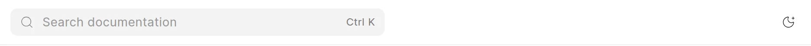
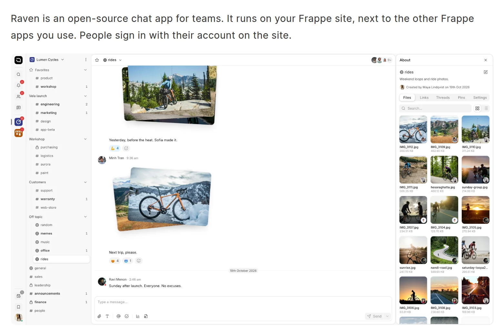

The reader and the app have a light theme and a dark theme. Each person picks a theme for their own browser.

## Change the theme in the reader

Do one of these:

- Click the moon or sun button in the header. On a phone, the button is in the header too.
- Press `Ctrl K` (`Cmd K` on a Mac), type `dark` or `light`, and pick **Theme: Dark** or **Theme: Light**.

<picture>
  <source srcset="../images/reading/theme-toggle-dark.webp" media="(prefers-color-scheme: dark)">
  
</picture>

## Change the theme in the app

Do one of these:

- Click **Frappe Wiki** at the top of the sidebar and click **Toggle Theme**.
- Press `Ctrl K` and pick **Toggle theme**. Type `dark` or `light` to get **Theme: Dark** or **Theme: Light**.

## How the wiki picks the theme

- The browser stores your choice. The reader and the app use the same choice, so a change in one also applies to the other.
- Until you pick a theme, the app follows the theme of your operating system.
- The reader also follows your operating system when the app has done so in the same browser. If you have never opened the app or picked a theme, the reader uses the light theme.

## Images with a dark version

An author can give an image a second version for the dark theme. Readers then see the version that matches the theme of the wiki. When you change the theme, the image changes without a reload. An image without a dark version shows the same in both themes.

See [Images](../authoring-content/images.md).

<picture>
  <source srcset="../images/reading/theme-image-dark.webp" media="(prefers-color-scheme: dark)">
  
</picture>
