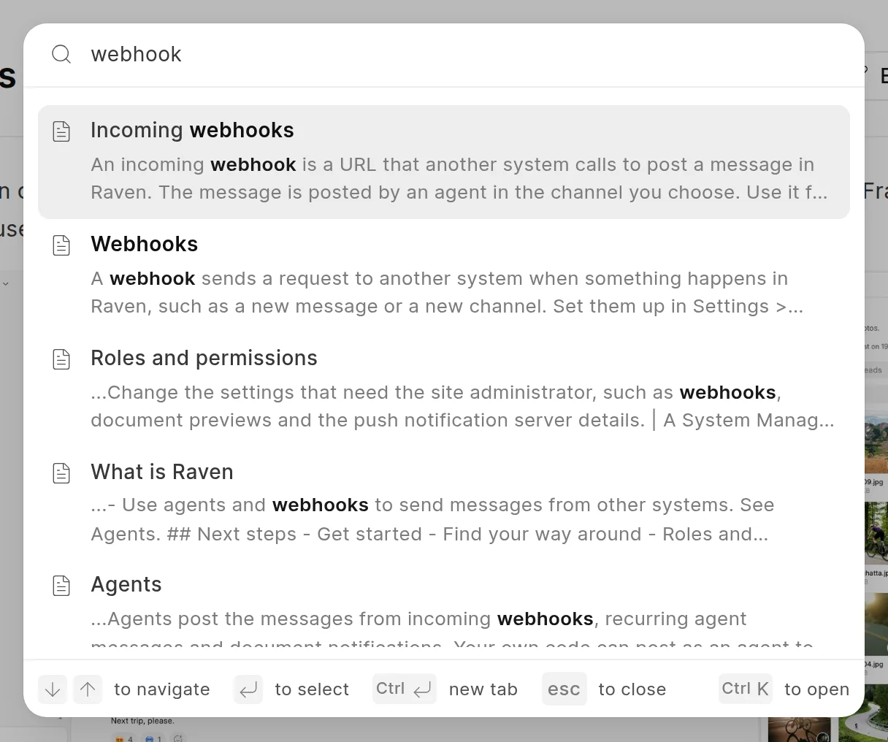
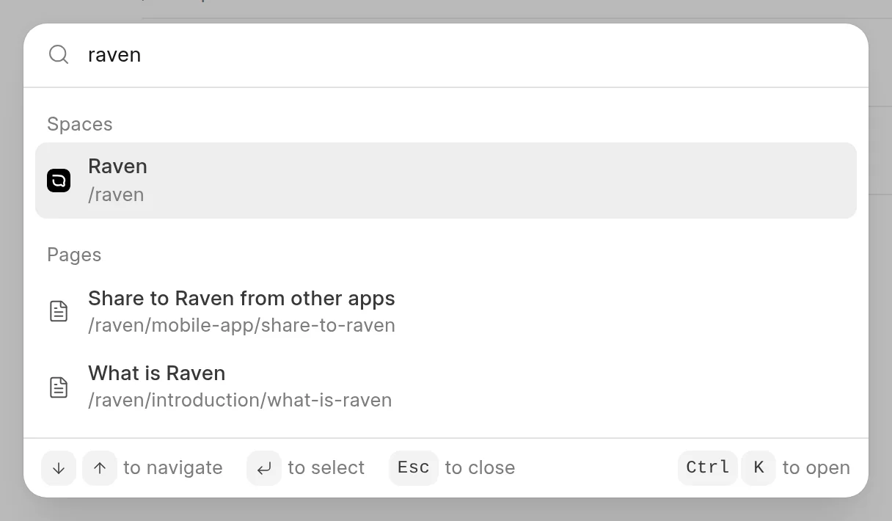

Press `Ctrl K` (`Cmd K` on a Mac) to search. The reader and the app each have their own search, and they find different things.

## Search in the reader

The reader search finds text in the published pages of the space you are in.

1. Click **Search documentation** in the header, or press `Ctrl K`. On a phone, tap the search button in the header.
2. Type a word or a phrase.
3. Use the arrow keys to pick a result and press `Enter`. You can also click a result.

<picture>
  <source srcset="../images/reading/reader-search-dark.webp" media="(prefers-color-scheme: dark)">
  
</picture>

- The search looks in the title and the text of each page.
- It shows only published pages in published spaces that you can read.
- It does not show groups or external links.
- Type `dark` or `light` to get an action that changes the theme. See [Light and dark mode](light-and-dark-mode.md).

Press `Esc` to close the search.

## Search in the app

In the app, the search palette takes you to a page, a space or a part of the app. Press `Ctrl K`, or click **Search** in the sidebar.

<picture>
  <source srcset="../images/reading/app-search-dark.webp" media="(prefers-color-scheme: dark)">
  
</picture>

The palette has these groups:

| Group | What it has |
| :--- | :--- |
| **Recent** | The last five pages you opened, when the search field is empty. |
| **Jump to** | **All Spaces** and **Change Requests**. |
| **Spaces** | Spaces that match the name. Unpublished spaces show only to Wiki Managers. |
| **Pages** | Pages whose URL matches the text, in all spaces you can read. |
| **Actions** | For example **New page**, **Space settings**, **Toggle theme** and **Log out**. |

Some rules for pages:

- The palette matches the URL of the page, not the title or the text. Type at least 2 characters. Spaces in your text match hyphens in the URL, so `getting started` finds `/docs/getting-started`.
- It shows unpublished pages too, with an icon.
- Pages in the space you are in come higher in the list.

:::note
A page keeps its first URL when you rename it. Search for the words in the URL, not the new title.
:::

In the editor, `Ctrl K` adds a link when you have selected text or when the cursor is in a link. Otherwise it opens the palette.

## Filter the page tree

In a space in the app, use **Search pages...** at the top of the page tree. It finds pages and groups in that space by title and URL, and shows them as a flat list.
