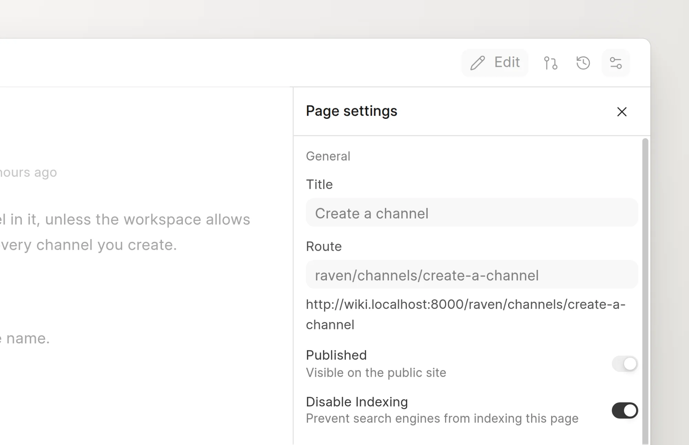

Turn on **Disable Indexing** to keep a published page out of search engines. Readers can still open and read the page.

## Hide a page

You must be able to write to the space. The setting saves directly on the page, without a change request.

1. Open the page in the wiki app.
2. In the page header, click **Page settings** (the settings icon).
3. Under **General**, turn on **Disable Indexing**.
4. Click **Save**.

<picture>
  <source srcset="../images/seo-and-aeo/disable-indexing-switch-dark.webp" media="(prefers-color-scheme: dark)">
  
</picture>

To show the page in search engines again, turn off **Disable Indexing** and click **Save**.

## What changes

When **Disable Indexing** is on:

- The public page has `<meta name="robots" content="noindex">` in its `<head>`.
- The Markdown version of the page sends the `X-Robots-Tag: noindex` header.
- The page is not in the [sitemap](sitemap.md).
- The page is not in the `llms.txt` index of the space. See [Markdown pages and llms.txt](markdown-and-llms-txt.md).

The tag is `noindex` only, not `nofollow`. Search engines still follow the links on the page to other pages.

## Limits

- The setting is for one page. A group does not have it, and pages do not inherit it. To hide many pages, turn it on for each page.
- The wiki search still finds the page.
- On a page that GitHub Sync manages, the setting stays editable. A sync does not change it.
- A search engine can take some time to remove a page that it already indexed.

## Disable Indexing, unpublished and private

| | Readers can open it | Search engines can index it |
| :--- | :--- | :--- |
| Published page | Yes | Yes, if the space is public |
| Published page with **Disable Indexing** | Yes | No |
| Unpublished page | No | No |
| Page in a private space | Only people with access | No |

On the public site, an unpublished page, or a page in an unpublished space, returns "not found" to everyone. Editors still see it in the wiki app. A private space has no Guest role, so search engines cannot read its pages. See [Who can read and write](../spaces/who-can-read-and-write.md).
