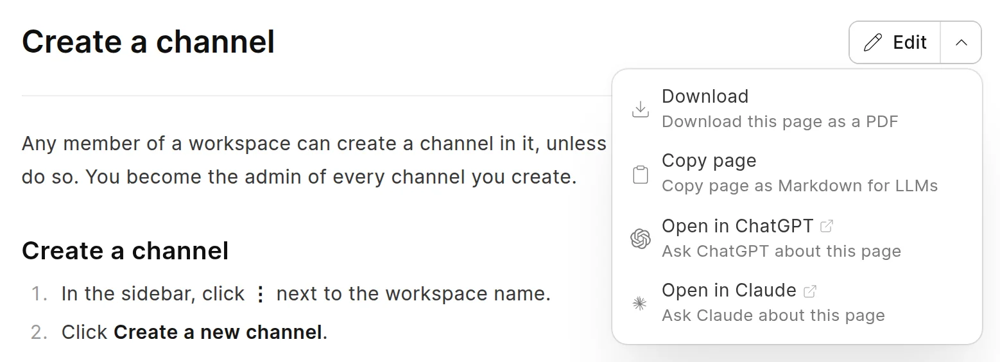

The wiki gives AI tools and answer engines your pages as plain Markdown. It also publishes `llms.txt` files, which list the public pages for these tools. You do not have to turn these features on.

## Markdown version of a page

Add `.md` to the URL of a page to get its Markdown source.

```
https://wiki.example.com/raven/channels/create-a-channel.md
```

The response starts with a front matter block, then the page content:

```markdown
---
title: "Create a channel"
description: "How to create a channel in a workspace."
space: "Raven"
url: "https://wiki.example.com/raven/channels/create-a-channel"
updated: "2026-10-30"
---
```

- `title` is the meta title, or the page title when the meta title is empty.
- `description` is the meta description. It is not there when the page has no meta description.
- `url` is the canonical URL of the page.
- `updated` is the date of the last change.

A tool can also ask for the normal page URL with the `Accept: text/markdown` header. It gets the same Markdown.

If you add `.md` to the URL of a space or a group, the wiki sends you to the Markdown version of its first page.

Each public page also links to its Markdown version with a `<link rel="alternate" type="text/markdown">` tag in its `<head>`.

## llms.txt files

An `llms.txt` file is an index of pages in Markdown, made for AI tools. See [llmstxt.org](https://llmstxt.org/) for the format. The wiki publishes two kinds:

| URL | What it lists |
| :--- | :--- |
| `/llms.txt` | Each public space, with a link to the `llms.txt` file of that space. |
| `/<space>/llms.txt` | Each page of the space, in sidebar order, with a link to its `.md` version. |

In the file of a space, groups show as bold items, and their pages show under them. When a page has a meta description, the description follows the link. The meta description of the first page of the space is also the summary of the space in both files. To set a meta description, see [Meta title, description and image](meta-tags.md).

The site file uses the **App Name** from **Website Settings** as its heading. If it is empty, the heading is the site name.

The wiki updates the files when a page or a space changes. Caches can keep a copy for up to one hour.

## Privacy

The `llms.txt` files show only public content. They always use the permissions of a guest, not the permissions of the person who opens them. They leave out:

- Private spaces, unpublished spaces and unpublished pages.
- Pages with **Disable Indexing** on. See [Hide a page from search engines](hide-from-search-engines.md).
- Groups that have no page left after these rules.

The `.md` version of a page follows the permissions of the page. A person who can read the page in the browser can also get its Markdown. For everyone else, the URL returns "not found". On a page with **Disable Indexing** on, the Markdown response has the `X-Robots-Tag: noindex` header.

## Ask an AI tool about a page

On a page in a public space, the page menu has **Open in ChatGPT** and **Open in Claude**. They open the AI tool with a question about the page.

<picture>
  <source srcset="../images/seo-and-aeo/page-menu-ai-actions-dark.webp" media="(prefers-color-scheme: dark)">
  
</picture>
