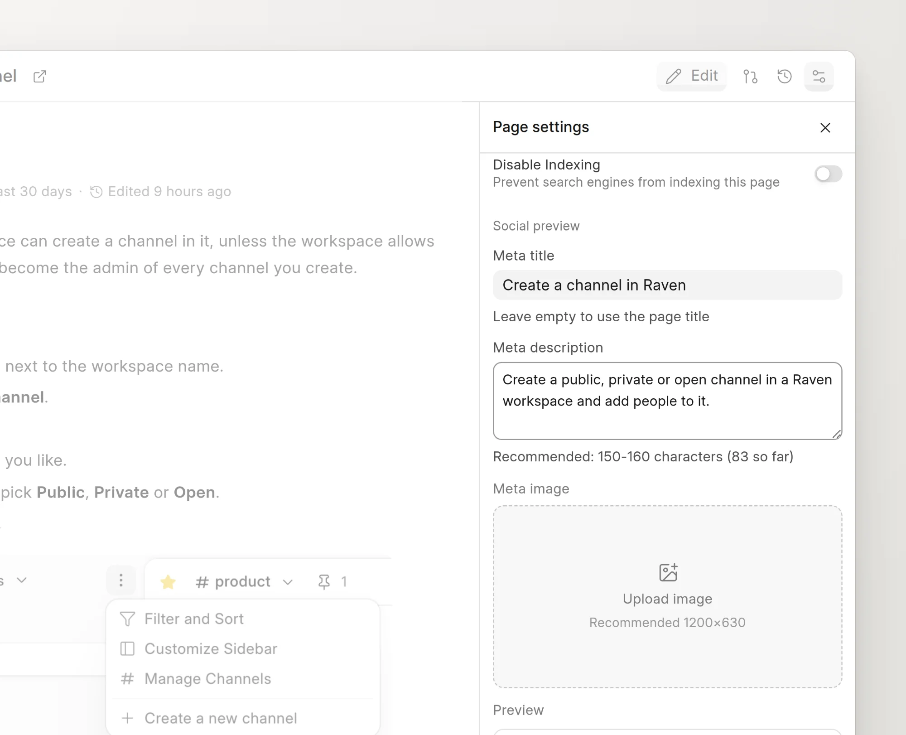

Each page has a meta title, a meta description and a meta image. Search engines show them in results. Chat apps and social networks show them in link previews.

## Set the meta fields

You must be able to write to the space. A change request is not necessary. The fields save directly on the page.

1. Open the page in the wiki app.
2. In the page header, click **Page settings** (the settings icon).
3. Under **Social preview**, enter a **Meta title**.
4. Enter a **Meta description**.
5. To add an image, click **Upload image** under **Meta image** and select a file.
6. Click **Save**.

<picture>
  <source srcset="../images/seo-and-aeo/page-settings-social-preview-dark.webp" media="(prefers-color-scheme: dark)">
  
</picture>

The **Preview** card under the fields shows the image, the route, the title and the description as you type. The changes go live on the public page when you click **Save**.

To change the image, point to it and click **Replace**. To remove it, click **Remove**.

## Defaults

| Field | When it is empty |
| :--- | :--- |
| **Meta title** | The wiki uses the page title. |
| **Meta description** | The page has no description tags. |
| **Meta image** | The wiki uses a generated social card. See [Social cards](social-cards.md). |

Use a description of 150 to 160 characters. The hint under the field counts the characters. Use an image of 1200 × 630 pixels. When **Auto Convert Image to WebP** is on in [Wiki settings](../administration/wiki-settings.md), the wiki converts PNG and JPEG uploads to WebP.

:::note
On a page that GitHub Sync manages, the meta fields stay editable. The repository does not carry them, so a sync does not change them. See [Sync a space](../github-sync/sync-a-space.md).
:::

## Tags on the public page

The public page puts these tags in its `<head>`:

- `<title>`, `title`, `og:title` and `twitter:title`, from the meta title.
- `description`, `og:description` and `twitter:description`, from the meta description.
- `image`, `og:image` and `twitter:image`, from the meta image or the social card. A social card also adds `og:image:width`, `og:image:height` and `og:image:type`.
- `twitter:card`. It is `summary_large_image` when the page has an image, and `summary` when it does not.
- `og:site_name`, from the space name, and `og:type` with the value `article`.
- `<link rel="canonical">`, the full URL of the page.
- `<link rel="alternate" type="text/markdown">`, the URL of the Markdown version. See [Markdown pages and llms.txt](markdown-and-llms-txt.md).
- A `BreadcrumbList` structured data block with the space and the page.

To keep a page out of search results, see [Hide a page from search engines](hide-from-search-engines.md).
