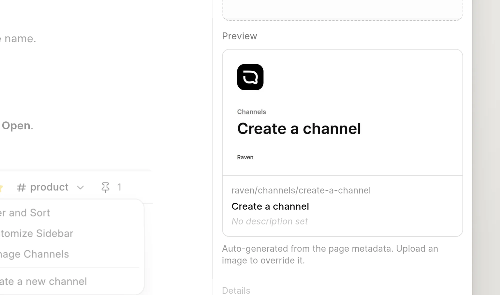

A social card is an image that the wiki makes for each page. Chat apps and social networks show it when someone shares a link to the page. The wiki uses it when the page has no meta image.

<picture>
  <source srcset="../images/seo-and-aeo/page-settings-generated-card-dark.webp" media="(prefers-color-scheme: dark)">
  
</picture>

## What the card shows

The card is 1200 × 630 pixels, in JPEG format. It always has a light background. It shows, from top to bottom:

- The space logo or the space icon.
- The groups above the page, up to two levels. If the page is deeper, the trail starts with `…`.
- The page title. Long titles use a smaller font and stop after three lines.
- The space name.

The card uses the page title, not the meta title. You cannot change the layout or the colors.

## Use your own image

Upload a **Meta image** in **Page settings**. Your image always replaces the social card on that page. See [Meta title, description and image](meta-tags.md).

In **Page settings**, the **Preview** shows the social card when the page has no meta image. The text under it says that the image is generated.

## Turn social cards off

1. Open [Wiki settings](../administration/wiki-settings.md).
2. In **General**, turn off **Auto Generate Meta Images**.

Pages without a meta image then have no image tags.

:::note
The server needs a card renderer. Frappe v16 and later include one. On Frappe v15, the wiki needs Node.js and the app's Node packages on the server. Without a renderer, the wiki makes no cards and the **Auto Generate Meta Images** setting does not show.
:::

## Privacy

A card follows the permissions of its page. For a page in a private space, or an unpublished page, the card URL returns "not found" to a person who cannot read the page.
