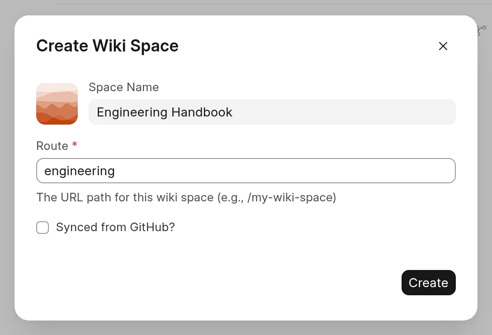

A space is a set of pages with its own URL, sidebar and access rules. Wiki Managers and System Managers can create spaces.

## Create a space

1. In the sidebar of the app, click **New Space**.
2. In the **Create Wiki Space** dialog, enter a **Space Name**.
3. Check the **Route**. The wiki fills it in from the name as you type, for example `engineering-handbook`.
4. Click **Create**.

<picture>
  <source srcset="../images/spaces/new-space-dialog-dark.webp" media="(prefers-color-scheme: dark)">
  
</picture>

The space opens in the app. Add pages to it. See [Edit a page](../authoring-content/edit-a-page.md).

On a phone, the **New Space** button is at the top of the **All Spaces** page.

## Fields in the dialog

| Field | What it does |
| :--- | :--- |
| Mark tile | The square to the left of the name. The wiki makes an abstract mark for every new space. Click the tile to pick an icon or upload a logo instead. See [Space appearance](space-appearance.md). |
| **Space Name** | The name in the sidebar, the space switcher and the reader header. |
| **Route** | The URL path of the space. Pages live under it, for example `/engineering/how-we-deploy`. This field is required. |
| **Synced from GitHub?** | Gets the pages from a GitHub repository. See [Connect a repository](../github-sync/connect-a-repository.md). |

## Routes

- Each space must have a different route.
- If you type a leading slash, the wiki removes it. `/engineering` becomes `engineering`.
- A route can have more than one part, for example `docs/v2`. A space at `docs/v2` owns the pages under `docs/v2/`, even when another space uses `docs`.
- If you edit the route yourself, the wiki stops filling it in from the name.

To change the route later, open **Space settings**, go to **General**, and click **Update** next to **Route Prefix**. The wiki moves every page in the space to the new route.

:::caution
A route change breaks the old URLs of the space. Links from other sites and from search engines stop working.
:::

## Settings of a new space

A new space starts with these settings. Change them in **Space settings**.

- **Published** is on. See [Who can read and write](who-can-read-and-write.md).
- The **Guest** role has **Read** access, so everyone can read the space, also people who are not logged in.
- **Accept Contributions**, **Collect Feedback** and **Allow PDF Download** are on.
- **Show in Space Switcher** is on. See [The space switcher](space-switcher.md).

:::tip
To keep a new space private, open **Space settings** > **Access** right after you create it. Remove the **Guest** role, add the roles that may read it, and click **Save**.
:::

## Copy an existing space

A Wiki Manager can copy a space with its pages and settings.

1. Open the space, click **...** next to its name, and click **Space settings**.
2. In **General**, click **Clone** next to **Clone Space**.
3. Enter a **New Space Route** and click **Start Cloning**.

The wiki makes the copy in the background.
