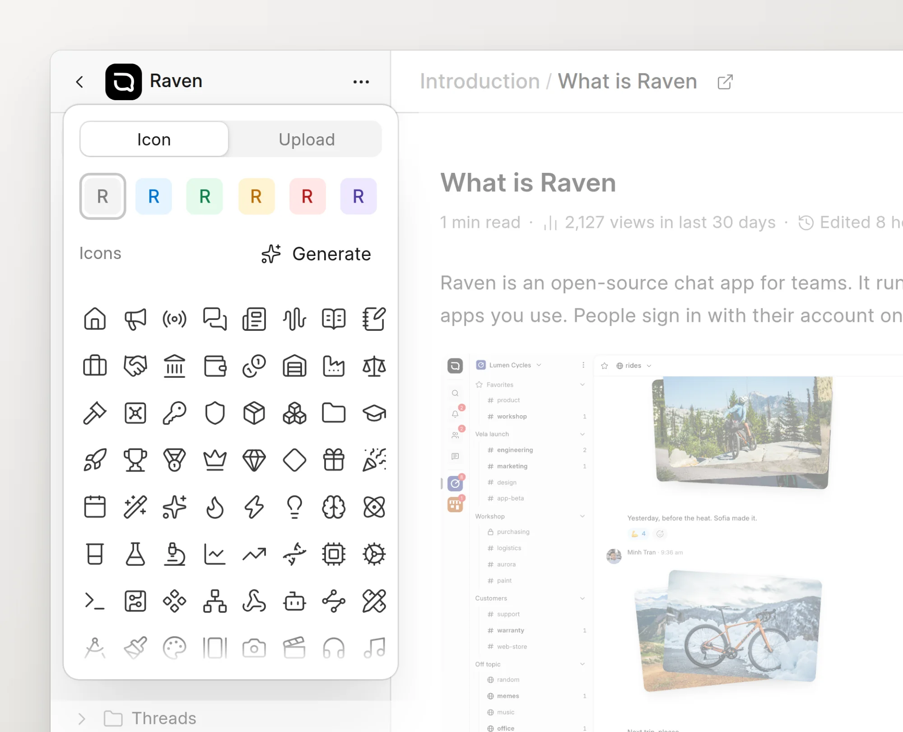
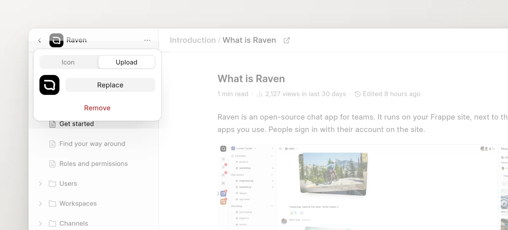

Each space has a mark: a small square that identifies it. The mark is a generated pattern, an icon on a color, or a logo that you upload.

## Where the mark shows

- In the app: the sidebar, the space header, the **Overview** page and the search palette.
- In the reader: the header, the mobile header and the space switcher.
- On the social preview image of each page, when the wiki makes one. See [Social cards](../seo-and-aeo/social-cards.md).

The app and the reader always show the same mark.

## Change the mark

You must have write access to the space.

1. Open the space in the app.
2. Click the mark next to the space name, at the top of the sidebar. You can also go to **Space settings** > **General** and click the tile next to **Space Logo**.
3. Pick an option in the popover. The wiki saves your choice immediately.

<picture>
  <source srcset="../images/spaces/mark-picker-icon-dark.webp" media="(prefers-color-scheme: dark)">
  
</picture>

### Icon tab

- Click a color in the top row: gray, blue, green, amber, red or violet.
- Click an icon in the grid.
- Click **Generate** to make a new abstract pattern. Click it again to get a different one.

### Upload tab

- Click **Upload** and pick an image file. A PNG or SVG works best, because the mark is small.
- Click **Replace** to upload a different image.
- Click **Use this image** to show the uploaded image again after you picked an icon or a pattern.
- Click **Remove** to delete the uploaded image.

<picture>
  <source srcset="../images/spaces/mark-picker-upload-dark.webp" media="(prefers-color-scheme: dark)">
  
</picture>

## Which mark wins

A space can store a pattern, an icon and an uploaded image at the same time. The wiki shows the first one that is set, in this order:

1. The generated pattern.
2. The icon on its color.
3. The uploaded image.
4. The first letter of the space name on a color.

When you pick an icon, the wiki removes the pattern but keeps the uploaded image. When you upload an image or click **Use this image**, the wiki removes the pattern and the icon.

## Favicon and logos in Desk

The space form in Desk, at `/app/wiki-space/<space ID>`, has more image fields. The app does not show them.

| Field | Use |
| :--- | :--- |
| **Favicon** | The icon in the browser tab on the reader pages of the space. If it is empty, the reader uses the Frappe Wiki icon. |
| **App Switcher Logo** | The same image as the **Upload** tab. |
| **Light Mode Logo** | Used on social preview images only when the space has no pattern, icon or uploaded image. |
| **Dark Mode Logo** | Not used by the reader. |
