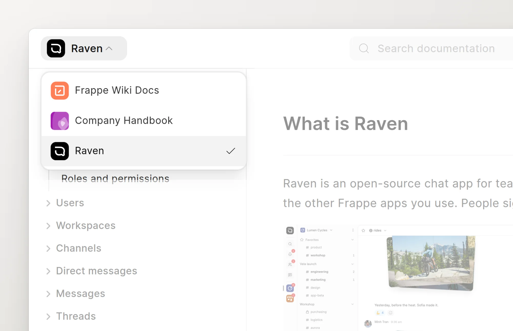
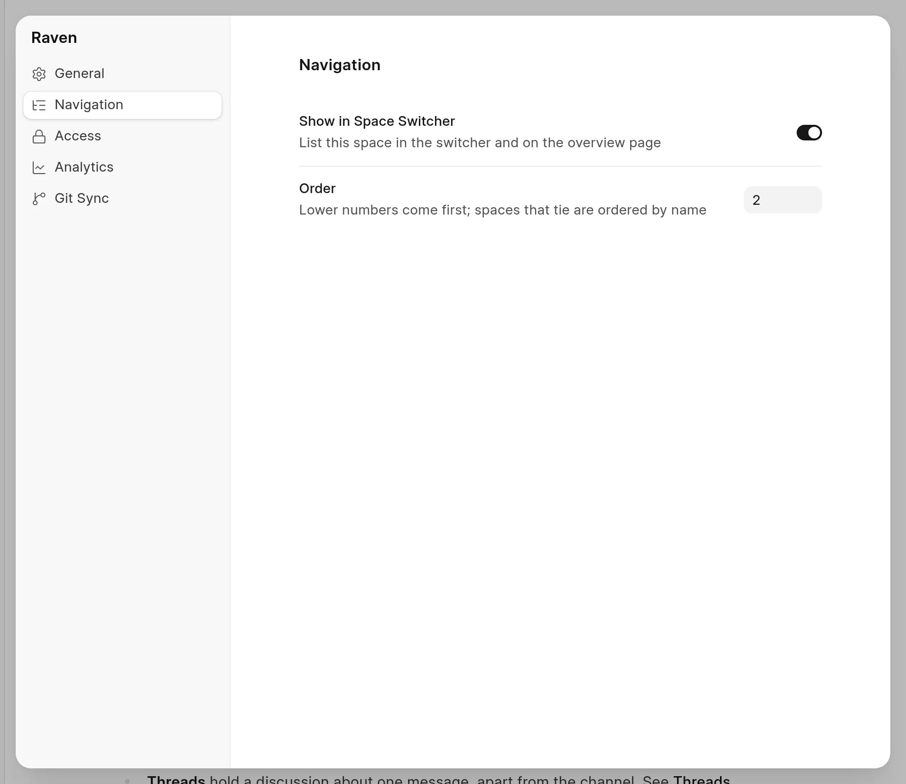

The space switcher lets readers move from one space to another in the reader. It is part of the space name at the top left of each page.

<picture>
  <source srcset="../images/spaces/reader-switcher-dark.webp" media="(prefers-color-scheme: dark)">
  
</picture>

## What readers see

- On a computer, click the space name in the header. A list of spaces opens. Click a space to go to it.
- On a phone, tap **Menu** at the bottom right, then tap the arrows next to the space name.

The list shows each space with its mark and name. The current space has a check mark.

A space is in the list only when all of these are true:

- The space is published.
- The reader can read the space. See [Who can read and write](who-can-read-and-write.md).
- **Show in Space Switcher** is on for the space.

The current space is always in the list, also when **Show in Space Switcher** is off for it.

If the list has only one space, the reader shows the space name without the switcher. For example, a visitor who is not logged in and can read only one public space does not see a switcher.

## Show or hide a space

You must have write access to the space.

1. Open the space, click **...** next to its name, and click **Space settings**.
2. Click **Navigation**.
3. Turn **Show in Space Switcher** on or off.

<picture>
  <source srcset="../images/spaces/navigation-panel-dark.webp" media="(prefers-color-scheme: dark)">
  
</picture>

A hidden space is still available at its URL.

## Set the order

In **Navigation**, enter a number in **Order**. Press Enter or click outside the field to save it.

- Spaces with lower numbers come first.
- Spaces with the same number are sorted by name.
- New spaces have the order `0`.

The order applies to the reader switcher only. The sidebar of the app shows pinned spaces first, then the spaces that were edited most recently.
