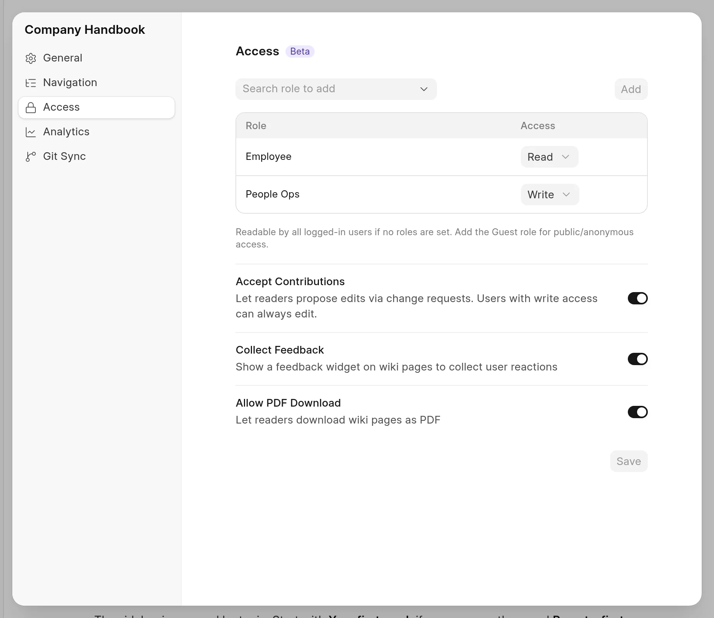

Each space has a list of roles. The list controls who can read the space and who can write to it. Set it in **Space settings** > **Access**.

<picture>
  <source srcset="../images/spaces/access-panel-dark.webp" media="(prefers-color-scheme: dark)">
  
</picture>

## Read and Write

Each row in the roles table gives one role an access level.

| Access | What people with the role can do |
| :--- | :--- |
| **Read** | Read the pages, and propose changes when the space accepts contributions. |
| **Write** | All that Read allows. Also merge change requests, change the space settings and change the roles table. |

- When a person has more than one role in the table, the highest level applies.
- Wiki Managers and System Managers can always read and write every space. They do not need a row.
- If the table is empty, every logged-in user can read the space. Only users with the **Wiki Approver** role can write to it.

## Change the roles

You must have write access to the space.

1. Open the space, click **...** next to its name, and click **Space settings**.
2. Click **Access**.
3. To add a role, type its name in **Search role to add**, pick it, and click **Add**. The new row has **Read** access.
4. To change a level, pick **Read** or **Write** in the **Access** column.
5. To remove a role, move the pointer over its row and click the delete icon.
6. Click **Save**.

The panel shows **Unsaved changes** until you click **Save**.

## Make a space public

Add the **Guest** role with **Read** access. Then everyone can read the space, also people who are not logged in. New spaces start with this row. See [Create a space](create-a-space.md).

People who cannot read a space get a **Page not found** error on its pages. Its pages do not show in their search results or in their space switcher.

## Accept contributions

**Accept Contributions** lets people with Read access propose edits through change requests. It is on for new spaces.

- When it is on, the reader shows the **Edit** button to every visitor. A visitor who is not logged in must log in first.
- When it is off, only people with Write access see **Edit**. Other readers see **Copy** in its place.
- People with Write access can always edit.
- A space that is synced from GitHub does not accept contributions. The switch is off and you cannot change it.

See [Contributions from readers](../change-requests/contributions-from-readers.md).

## Published and unpublished

The **Published** switch is in **Space settings** > **General**.

- When a space is published, readers can open its pages.
- When a space is not published, the reader shows **Page not found** for all its pages, also to Wiki Managers. Its pages do not show in the reader search or in the space switcher.

In the app, unpublished spaces show in a separate **Unpublished** group in the sidebar. Only Wiki Managers and System Managers see that group.
